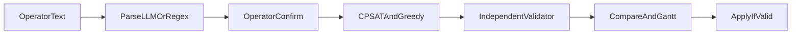

# RailFlow — full product build

## Current state

The repo at [C:\Users\Gurjas Gandhi\OneDrive\Desktop\RailFlow](C:\Users\Gurjas Gandhi\OneDrive\Desktop\RailFlow) is a **design bundle only**. Product code (`backend/`, `web/`, `AGENTS.md`, start scripts) does not exist.

**Keep as-is (do not regenerate):**
- [data/station_shivneri.json](data/station_shivneri.json), [data/timetable_normal.json](data/timetable_normal.json), [data/timetable_conflicts.json](data/timetable_conflicts.json)
- [data/demo/](data/demo/) workbook + radio clips + [data/demo/radio_transcripts.txt](data/demo/radio_transcripts.txt)
- [docs/SPEC.md](docs/SPEC.md) (source of truth), [docs/JUDGE_AUDIT.md](docs/JUDGE_AUDIT.md)
- [tools/reference/](tools/reference/) oracle — product code **must never import** it

**Must create:** full [AGENTS.md](AGENTS.md) tree, generated data (`timetable_peak.json`, `scenarios.json`, `parser_eval.jsonl`), all tests, README, then commit + push to existing `origin/main` (`https://github.com/Gurjas2112/RailFlow.git`).

Work stays in this git repo (already has `origin`). Use `pathlib` everywhere so OneDrive path spaces do not break scripts.

## Thesis (never break)

The planner may be wrong; the validator cannot be fooled; the AI never touches a platform.

- Occupancy everywhere: `[arr, dep + min_gap)` vs closures `[start, end)`
- V8 always reports `stay_overlap_min`, `clearance_shortfall_min`, `reserved_overlap_min`
- Arrival vs departure delays accounted separately; dwell = original + cumulative **departure** delay
- Lexicographic objective: Σπ·unassigned, then primary, then secondary
- UI VALID badge comes only from `validator.py`; Recovery badge is separate
- `validator.py` imports only `.models` + stdlib; sweep line; reports every pair
- AI outputs only `Disruption[]` or explanation text; operator must confirm before plan

## How we implement

Copy starter blocks from [docs/SPEC.md](docs/SPEC.md) (§7 planner, §8 greedy, §9 validator, §10 parsers, §11 reasons, §13 tokens, §15 pose, §30 auth, §31 schema/apply, §32 models, §33 security, §34 events, §39 start, §40 import, §41 STT, §44 affected set). Fix bugs found in those blocks; match [tools/reference/REFERENCE_RUN.md](tools/reference/REFERENCE_RUN.md) via `test_reference_parity.py`.

Do **not** start Phase N+1 until that phase’s checks are green. Tier 3 (Phases 3–5 extras) starts only after Tier 1 + Tier 2 tests pass.

---

## Phase 0 — Scaffold and freeze contracts

Create the exact layout from AGENTS.md §4.

- Write [AGENTS.md](AGENTS.md) from the provided v1.7 instructions
- [backend/railflow/models.py](backend/railflow/models.py): all §6 entities + IR fields from §46 + `ValidationReport`, `Conflict`, `Revision`, `Assignment`, `PlanInput`, proposals; Pydantic rules from §32
- [backend/railflow/schema.sql](backend/railflow/schema.sql) from SPEC §31 (users include `lang`)
- [backend/railflow/main.py](backend/railflow/main.py): every route from AGENTS.md §6 / SPEC §17 returning canned JSON that matches the models; `GET /api/health`
- Empty-but-importable stubs for every other `backend/railflow/*.py` module
- Frontend: Vite + React 19 + TS strict + Tailwind v4 + [web/src/design/tokens.css](web/src/design/tokens.css) (§13) + i18n (`en.json`, `t()` on every string) + local fonts + router `/login`, `/invite/:token`, `/`, `/admin` + mobile-first layout shell on canned data
- [.gitignore](.gitignore), [.env.example](.env.example), [backend/requirements.txt](backend/requirements.txt)
- Generate [web/src/api/schema.d.ts](web/src/api/schema.d.ts) from `/openapi.json`

**Gate:** backend starts; frontend shell at 360 px and 1366 px; `git check-ignore .env` prints `.env`.

---

## Phase 1 — Core algorithms, data, storage, Gantt (Tier 1 core)

Implement from SPEC, then wire real routes.

- [backend/railflow/timeutil.py](backend/railflow/timeutil.py), [state.py](backend/railflow/state.py) (`affected_set()`, `occupancy_after()` from §44)
- [planner_greedy.py](backend/railflow/planner_greedy.py) §8, [planner_cpsat.py](backend/railflow/planner_cpsat.py) §7 (seed 42, 5 s, 8 workers, two-stage affected-set)
- [validator.py](backend/railflow/validator.py) §9 V1–V10, v1.4 V4/V5/V7 from §43, **independent**
- [metrics.py](backend/railflow/metrics.py), [db.py](backend/railflow/db.py) (WAL, FKs, `integrity_check`, revision SHA-256), [audit.py](backend/railflow/audit.py)
- [timetable_import.py](backend/railflow/timetable_import.py) §40: named cells `MinClearance` / `MaxHold`, IR headers, derived allowed PFs
- Real: `/api/scenario/load`, `/reset`, `/validate/scheduled`, `/assign`, `/timetable/upload`
- [tools/make_data.py](tools/make_data.py) seed 42: generate `timetable_peak.json`, `scenarios.json` (S1–S8 + S2-late), `parser_eval.jsonl` (50 + 2 radio transcripts); **assert** JSON twins equal workbook import
- Frontend: [web/src/gantt/Gantt.tsx](web/src/gantt/Gantt.tsx) §16 + [TimetableUpload.tsx](web/src/panels/TimetableUpload.tsx)

**Tests:** `test_validator`, `test_validator_independence`, `test_planner_properties`, `test_delay_accounting`, `test_objective_hierarchy`, `test_capacity`, `test_recovery_status`, `test_reference_parity`, `test_timetable_import`.

**Parity targets** from [REFERENCE_RUN.md](tools/reference/REFERENCE_RUN.md):
- S3: GAP P1 11214↔11216 (2), GAP P2 51218↔51219 (3), OVERLAP P4 51214↔51215 (stay 5 / reserved 10)
- S1: 0 affected, all VALID / FULLY_ASSIGNED / 0 changes
- S2 @ 13:50: affected {11209, 51219, 11217}, 3 moves, hold 16, weighted 45
- S8 @ 14:10: affected {51218, 51215, 51219, 11217}; min_delay 2/76 vs min_changes 1/136
- S5: OVERLAP P1 12222↔51215
- Hierarchy: GDS-4105 held 20, 0 unassigned

**Gate:** `pytest -q` green for Phase 1 tests; workbook “Timetable as scheduled” shows the 3 conflicts.

---

## Phase 2 — Disruptions, AI, plan, apply (Tier 1 remainder + Tier 2)

- [parser_regex.py](backend/railflow/parser_regex.py), [proposals.py](backend/railflow/proposals.py) (Devanagari digits, aliases, spoken IDs from §41/§46), [parser_llm.py](backend/railflow/parser_llm.py) (Ollama `qwen2.5:3b`, 8 s, fallback regex, `parser_path`)
- `/api/disruptions/parse` never mutates state
- `/api/plan`: frozen at `now`, split delays, two-stage solve, `affected` / `widened` / `moved_outside_affected`, three revisions each with own `ValidationReport`, [fault.py](backend/railflow/fault.py), [reasons.py](backend/railflow/reasons.py) `{code, params}` + `caused_by`
- [explainer.py](backend/railflow/explainer.py) + `/api/explain` (ungrounded number → template; hi/mr always template)
- Apply exactly as SPEC §31: hash check, re-validate, one transaction, 409 if invalid/faulted/hash-mismatch
- Frontend: Disruption (parse → spans → confirm), Compare (validator badge, Recovery badge, Apply disabled if invalid, fault banner), Changes + ReasonCard

**Tests:** `test_parser`, `test_explainer_grounding`, `test_api`, `test_departure_delay`, `test_affected_set`, `test_cascade`.

**Gate:** S2 @ 13:50 end-to-end; S2-late rejected; S8 trade-off visible; S4 rejected; S5 NOT VALID + Apply disabled; Ollama down → regex/template chips.

---

## Phase 3 — Auth, roles, admin (Tier 3, only if Tier 1+2 green)

- [auth.py](backend/railflow/auth.py) §30: Argon2id, opaque SHA-256 sessions, idle 30 min / absolute 8 h, lockout 5/15 min, dummy-hash, `require_role`, admin cannot parse/plan/apply
- Invites single-use 24 h; [security.py](backend/railflow/security.py) §33 CSP `default-src 'self'`, Origin check, 256 KB body, redaction
- [manage.py](backend/railflow/manage.py): init-db, create-admin, seed-demo, unlock, backup
- [events.py](backend/railflow/events.py) + [admin.py](backend/railflow/admin.py)
- Frontend: Login (no signup), AcceptInvite, role-aware header, admin Dashboard (6 panels, Recharts, 5 s poll), Users, AuditVerify

**Tests:** `test_auth.py` (§20.7 all seven), `test_storage_integrity.py` (§20.8).

**Gate:** viewer → Apply 403; admin → Plan 403; both visible in audit + dashboard.

---

## Phase 4 — 3D, layouts, languages (Tier 3, gated)

- [web/src/sim/pose.ts](web/src/sim/pose.ts) exactly §15; Station3D / Train / Platform / SimClock / TopView2D
- PhoneLayout (tabs Station · Disrupt · Compare · Changes), TabletLayout, DesktopLayout
- [web/public/locales/hi.json](web/public/locales/hi.json) + [mr.json](web/public/locales/mr.json); Vitest `locales.test.ts`
- Mobile: TopView2D default &lt;768 or no WebGL; reduced-motion respected

**Gate:** Vitest green; S2 before/after; EN / हिं / मर on every screen.

---

## Phase 5 — Evidence, demo serve, README, ship

- [stt.py](backend/railflow/stt.py) + `/api/disruptions/transcribe` + RadioInput **only if** Phase 4 gate passed; else skip and say so
- Demo-mode static serving in `main.py` (§39); [start.ps1](start.ps1) / [start.sh](start.sh)
- [tools/gen_scenarios.py](tools/gen_scenarios.py), [bench.py](tools/bench.py) → `results/bench.md`; [eval_parser.py](tools/eval_parser.py) → `results/parser_eval.md`
- Full [README.md](README.md): setup, four run commands, demo accounts, occupancy definition, V1–V9, role table, limitations §24, hi/mr need native review
- Grep pass: no hard-coded UI strings, no external URLs, no leftover prints
- Mark AGENTS.md §9 definition-of-done pass/fail

**Ship (explicitly requested):** one commit on `main` (or a small series of phase commits, then merge), then `git push origin main`. Do not commit `.env` or `data/railflow.db`.

## Stack (fixed — no substitutes)

Python 3.12, FastAPI, Pydantic v2, ortools, argon2-cffi, sqlite3, pytest, hypothesis. React 19, Vite, Tailwind v4, zustand, i18next, three/R3F. No Docker, Postgres, ORM, CDN, or cloud LLM.

## Out of scope unless Tier 1+2 are already green and time remains

- Route conflicts V11 / `model_routes` (SPEC §48) — last Tier 3 item; expected numbers in [ROUTE_EXPERIMENT.md](tools/reference/ROUTE_EXPERIMENT.md)
- Do not add features not in the spec
