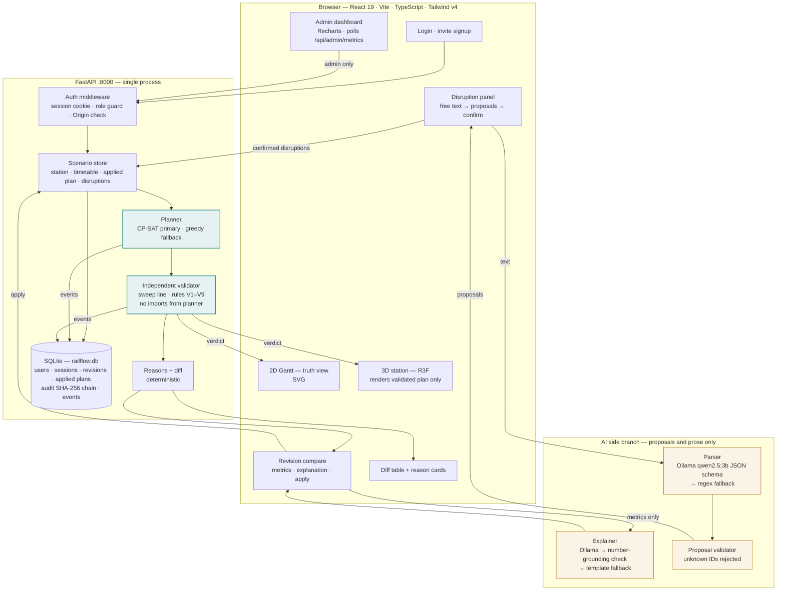
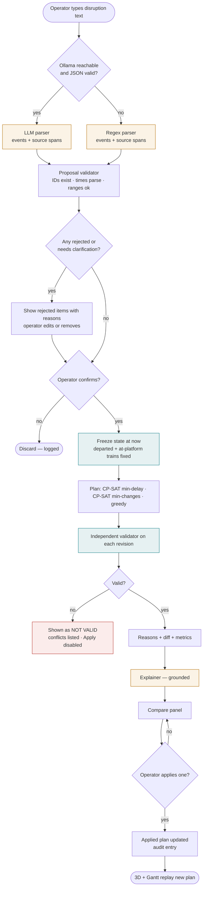

# RailFlow — Railway Disruption & Platform Conflict Simulator

### Engineering, product and experience specification

**VORTEXA 3.0 · Problem Statement P-03 · Domain 6 — Public Systems & Civic Technology**
12-hour build · AIRS, Dr. D. Y. Patil Institute of Technology, Pimpri, Pune · v1.7, final

> **v1.7 change note.** Adds Part XIII (§48), a Tier 3 roadmap for route conflicts in the station throat between opposite-direction movements. It covers the model, a conflict table for SVNJ, the planner change, validator rule V11 and a measured experiment: 7 crossings in the current data, all resolved by CP-SAT. It is off by default; the MVP is unchanged.
>
> **v1.6 change note.** Judge-driven reconciliation (Part XII, `docs/JUDGE_AUDIT.md`), verified by a reference model run on the shipped data (`reference/REFERENCE_RUN.md`):
> - three conflict measures;
> - separate arrival and departure delay accounting;
> - goods capacity in wagons (new rule V10);
> - named workbook cells;
> - a sequential lexicographic objective;
> - separate validator and recovery badges;
> - S2 moved to 13:50;
> - real trade-off numbers from S8, replacing invented ones;
> - a reference-parity test;
> - the MVP tiered.
>
> §7, §8, §9, §10.2, §14, §22, §23, §40 and §45 are corrected in place.
>
> **v1.5 change note.** Adds Part XI: the timetable now follows the Indian Railways working-timetable format — 5-digit train numbers by category (12xxx SF, 11xxx Mail/Express, 51xxx Passenger, 61xxx MEMU, GDS goods paths), IR precedence (priority 1–4), From/To station codes, UP/DN, halt, PF numbering, platform length in coaches and days of run. Times, conflicts and the S8 cascade are unchanged; every train ID in this document is renumbered.
>
> **v1.4 change note.** Adds Part X after an evaluator review against P-03: departure delays for trains already at a platform (§43), two-stage affected-set replanning so untouched trains never move (§44), and a visible delay cascade with `caused_by` chains and scenario S8 (§45). Sections 2, 6, 7, 9, 22–24 are updated to match.
>
> **v1.3 change note.** Adds Part IX: a demo spreadsheet timetable (`.xlsx`, 30 trains, exactly 3 planted conflicts, formula answer key) with `.xlsx`/`.csv`/`.json` import, and two radio-report clips (English, Hindi) with optional local speech-to-text feeding the same parser and confirmation gate. Sections 2, 6, 17–20, 22, 24, 25, 27, 28, 32 and 33 are updated to match.
>
> **v1.2 change note.** Adds Part VIII: English, Hindi and Marathi throughout; layouts for phone, tablet and desktop; and full independence (offline, no cloud, no CDN, one process, one port). Sections 10, 11, 13–16, 18–20, 22, 24, 25, 27, 28 and 33 are updated to match.
>
> **v1.1 change note.** Adds Part VII: an evidence-based relevance check of authentication, admin observability, storage, data validation, security and regulation against P-03. Kept items are built inside the existing app; everything else is cut with a reason. Sections 1, 2, 4, 12, 14, 15, 17–20, 22–25, 27 and 28 are updated to match.

> **One-line thesis.** The planner may be wrong; the validator cannot be fooled; the AI never touches a platform. RailFlow turns a free-text disruption report into a conflict-free, independently validated platform plan in seconds, and shows the operator exactly what changed and why, both as a 2D Gantt and as a live 3D station.

## How to read this document

This is a **single recommended path**, not a menu. Every tool is the one pick for its layer. Parts I–II say what to build and why. Part III specifies the algorithms with working code. Part IV covers the interface, including the 3D station. Part V is the 12-hour build, the tests and the pitch. Part VI takes your laptop from empty to demo-ready.

**The governing trade.** When the 3D view and the planner/validator compete for hours, the planner/validator wins. A beautiful station running an unvalidated timetable loses to a plain Gantt that is provably conflict-free. The 3D view is a *renderer of validated data*, never a source of truth.

## Contents

**Part I — Position**
1. Scope and scoring logic
2. Requirement traceability matrix
3. Users and scenarios

**Part II — System**
4. System architecture
5. End-to-end disruption flow
6. Domain model and time semantics

**Part III — Algorithms**
7. Planner — CP-SAT (primary)
8. Planner — greedy (baseline and fallback)
9. Independent validator
10. AI layer — disruption parser and trade-off explainer
11. Change reasons and diff classification
12. Audit log

**Part IV — Interface**
13. Design tokens
14. Screen specification
15. The 3D station
16. The 2D Gantt (truth view)

**Part V — Build and pitch**
17. API contract
18. Repository layout
19. 12-hour build plan
20. Testing
21. Benchmark
22. Demo pack and demo script
23. Judge Q&A
24. Limitations
25. Risk register

**Part VI — Setup**
26. Your machine — compatibility verdict
27. Installation
28. Run commands and submission checklist

**Part VII — Platform: access, data, monitoring, compliance** *(v1.1)*
29. Relevance check — what P-03 needs and what it doesn't
30. Identity and access
31. Data storage and retrieval
32. Data verification and validation
33. Data security
34. Admin dashboard — Operations & System Health
35. Regulatory parameters

**Part VIII — Reach: languages, devices, independence** *(v1.2)*
36. Relevance check — what was added and what was not
37. Multilingual: English, Hindi, Marathi
38. Any-device responsive design
39. Independence: offline, self-contained, one process

**Part IX — Demo assets** *(v1.3)*
40. Demo spreadsheet
41. Radio report and speech-to-text
42. Relevance and cost summary

**Part X — Evaluator fixes** *(v1.4)*
43. Departure delays
44. Affected-set replanning
45. Visible delay cascade (S8)

**Part XI — Indian Railways conventions** *(v1.5)*
46. Working-timetable format

**Part XII — Judge-driven reconciliation** *(v1.6)*
47. Fixes (conflict measures · delay accounting · goods capacity · named cells · lexicographic objective · recovery status · corrected scenarios · reference parity · positioning)

**Part XIII — Route conflicts** *(v1.7 · Tier 3)*
48. Opposite-direction movements in the station throat

---

# Part I — Position

## 1. Scope and scoring logic

P-03 asks for five things: conflict-free platform assignment with a minimum gap, conflict detection reported by train and platform, replanning after delays and closures with recorded reasons, **independent validation** of every revised timetable, and AI that converts free text into disruptions and explains trade-offs **without deciding assignments**.

Judging criteria: Innovation, Technical Implementation, Impact, Feasibility, UX, Presentation. Judges test live.

### The two tests

Every element outside the five graded requirements must either **make a graded requirement provable in front of a judge**, or **make the demo memorable**. Anything failing both was cut.

| Element | Verdict | Reason |
|---|---|---|
| CP-SAT planner + greedy baseline | ✅ **build** | "Real method you can explain" and a measured comparison. Greedy is also the fallback if CP-SAT times out. |
| Independent validator with fault injection | ✅ **build** | The PS's strongest requirement, made visible. Fault injection proves the validator is real. |
| AI parser with confirmation + regex fallback | ✅ **build** | Meaningful AI (extraction), honest local fallback, rejection of unknown IDs. |
| Grounded trade-off explainer | ✅ **build** | AI explains numbers it is given; every number in its output is checked against the metrics. |
| Two revisions side by side (min-delay vs min-changes) | ✅ **build** | "Understand the trade-offs" is in the problem overview. Two concrete revisions make it tangible. |
| 3D station simulation | ✅ **build, time-boxed** | The memorable moment. Hard cut at 17:30 to the animated 2D top view. |
| Hash-chained audit log | ✅ **build, small** | "Recording the reasons for each change" becomes tamper-evident in 30 minutes. |
| Login with three roles (viewer, controller, admin), invite-only signup | ✅ **build, small** | Not named by the PS. But "who confirmed this disruption and who applied this plan" is the accountability a control room needs, and server-side role checks make the audit log meaningful. Public self-signup is cut: a control-room tool must not let strangers create accounts (§29–30). |
| Admin dashboard (Operations & System Health) | ✅ **build, small** | Makes graded concerns visible live: validator verdicts, solver status, AI fallback rate, platform utilisation. Built into the same app, with no Grafana stack (§34). |
| SQLite database | ✅ **build** | Persists users, sessions, revisions, applied plans, audit and events across restarts with zero setup (§31). |
| Postgres, Docker, Keycloak, Grafana | ❌ **cut** | Four extra services on a venue laptop for one station and three roles. Named as the production path only. |
| Live railway data, maps | ❌ **cut** | Forbidden by the PS. Fictional station only. |
| Multi-station network, route/track conflicts | ❌ **cut** | Out of scope; stated honestly in Limitations. |

---

## 2. Requirement traceability matrix

Put this table on a slide. It tells judges, line by line, where each requirement lives and how to test it.

| Requirement (PS P-03 / Common Rules) | Where it lives | How a judge tests it live |
|---|---|---|
| Station defined by platforms and minimum gap | `data/station_shivneri.json`, editable in the Scenario panel | Change `min_gap` from 5 to 8 → re-plan → validator still green, more holds appear |
| Timetable: trains, arrival/departure, required platform | `data/timetable_*.json`, upload or edit | Upload a JSON with two trains on the same platform |
| No double occupancy, gap respected | CP-SAT `AddNoOverlap` on intervals of size `dwell + gap` (§7) | Any plan → Gantt shows spacing ≥ gap; validator green |
| Detect overlapping/infeasible assignments, report by train and platform | `validator.validate()` (§9), "Check as scheduled" button | Load conflict scenario S3 → red list: `GAP_VIOLATION P2: 11203 ↔ 11207, 3 min` |
| Delays of stated length | `Delay{train_id, minutes}` (§6) | Type "11209 running 25 min late" |
| Platform closures for stated periods | `Closure{platform_id, start, end}` (§6) | Type "P3 closed 14:00–15:30" |
| Replan affected trains, same constraints | `plan()` re-runs from current state with frozen trains (§7) | Apply → diff table lists only affected trains |
| Record reasons for each change | `reasons.py` deterministic reasons (§11) + audit log (§12) | Click any moved train → reason card |
| Independent validation of every revision | `validator.py` imports nothing from the planner, different algorithm (sweep line) (§9) | Toggle **Inject planner fault** → plan shown as **NOT VALID**, Apply disabled |
| Failed timetable never presented as valid | UI renders the validator verdict, not the planner's status (§14) | Same as above |
| AI converts free text to delays/closures | `parser_llm.py` with JSON schema, operator confirmation (§10) | Any natural sentence; edit proposals before confirming |
| AI explains trade-offs in plain language | `explainer.py` with number-grounding check (§10) | Compare panel → explanation; every number matches the table |
| AI must not decide platform assignments | Architecture: AI output is only `Disruption[]` or text; planner never reads AI text (§4) | Show the data flow slide; AI output types cannot express an assignment |
| AI used meaningfully | Extraction of structured events from free text, measured on a labelled set (§20.4) | Show parser accuracy table: LLM vs regex |
| Correctness by explicit, checkable rules | Planner constraints + validator rules V1–V9 (§9) | Read the rule list; run the property test |
| Reproducible live testing, permitted inputs | Built-in scenarios S1–S7, seeded random generator, JSON upload | Reset → identical results (CP-SAT is seeded, single result per input) |
| Fictional data only | Fictional "Shivneri Junction (SVNJ)", fictional station codes and names; IR-format 5-digit numbers (§46) | — |
| Indian Railways working-timetable format *(v1.5)* | Train No., Type, From/To, Dir, Arr/Dep, Halt, PF, coaches, days of run (§46) | Open the workbook: columns match an IR station working timetable |
| No paid API; local fallback for AI | Ollama on the laptop; regex parser and template explainer when it is down | Stop Ollama live → parse and explain still work, path shown as `regex` / `template` |
| Working MVP, not mockups | Everything above runs on `localhost` | — |
| Accountability for confirming disruptions and applying plans *(v1.1)* | Server-side role checks (§30); actor recorded in every audit entry (§12) | Log in as viewer → Apply returns 403, and the refusal appears in the audit log |
| Applied plan is exactly the validated plan *(v1.1)* | Revision hash stored at validation; apply re-hashes and re-validates (§31) | Alter a stored revision in SQLite → Apply refused with `HASH_MISMATCH` |
| Monitoring of system behaviour *(v1.1)* | Admin dashboard (§34) | Run S5 and S7 → the invalid-revision and regex-fallback counters move |
| Timetable from a real spreadsheet *(v1.3)* | `timetable_import.py` + `shivneri_timetable_demo.xlsx` (§40) | Upload the workbook → exactly the 3 conflicts in its Answer key; edit a time in Excel → the result changes |
| Delay at a platform spreads to later trains *(v1.4)* | Departure delays (§43) + cascade with `caused_by` (§45) | Run S8 → 4 of 30 affected, chain shown in the reason card |
| Only affected trains are replanned *(v1.4)* | Two-stage solve over the affected set (§44) | Compare panel: "moved outside affected set: 0" |
| Disruption arrives by radio *(v1.3)* | Radio clip → local speech-to-text → same parser and confirmation (§41) | Play `radio_s2_en.wav` → transcript → Parse → Confirm |

---

## 3. Users and scenarios

Three people. Every screen exists because one of them needs it.

### A — Meera, Station Operations Controller, peak afternoon

Shivneri Junction, 13:50. Five platforms, a 5-minute minimum gap, 30 trains between 12:00 and 17:00. The control room radio crackles: an express is running 30 minutes late, and the permanent-way team wants Platform 3 for an inspection from 14:00 to 15:30. Meera types exactly what she heard into one box. RailFlow shows two structured events, each highlighting the words it came from. She corrects nothing, presses **Confirm**, and within two seconds sees two revisions side by side: one minimises delay, one minimises platform changes. A green **VALIDATED — 0 conflicts** badge sits on both. She reads the three-sentence explanation, picks the minimum-delay plan and presses **Apply**. The 3D station replays the next hour: trains glide into their new platforms, the closed platform glows red, delayed trains carry amber tags.

*Forces:* free text in, structured events out, confirmation before effect, two revisions, a validator verdict she can trust, reasons she can read out to the platform staff.

### B — Rohit, Divisional Timetable Planner, before the day starts

Rohit loads tomorrow's timetable with the platforms the old spreadsheet assigned. He presses **Check as scheduled**. Three conflicts appear, each with the two trains, the platform and the size of the violation in minutes. He presses **Assign platforms**, and RailFlow returns a conflict-free plan that keeps every required platform. The Gantt is his working view; he never opens the 3D view.

*Forces:* conflict detection on an input timetable, required platforms honoured, a Gantt that a planner trusts.

### C — The judge

The judge wants to break it. They type an unknown train number; it is rejected, not guessed. They close two platforms at peak; some trains become **UNASSIGNED** with a reason, and the plan is still valid. They flip **Inject planner fault**; the validator catches the planted overlap and the Apply button disables itself. They kill Ollama; the parser path flips to `regex` and keeps working.

*Forces:* every claim in the pitch is something the judge can try.

---

# Part II — System

## 4. System architecture

One Python process owns every decision; one browser renders it. The AI is a side branch whose outputs can only be *proposals of disruptions* or *text about numbers*. It has no path to an assignment.



*Figure 1 — Architecture. Teal: the load-bearing correctness path. Amber: the AI branch. Note the two arrows into the AI branch: the parser receives operator text, the explainer receives computed metrics. Neither output type can carry a platform assignment, so "AI must not decide platform assignments" is enforced by the types, not by a promise. Every request passes the auth middleware before it reaches the scenario store, and every decision lands in one SQLite file.*

### Why one Python process

Everything runs on one laptop at the venue. FastAPI with a single SQLite file removes Docker, database-server and network failure modes. CP-SAT runs in-process on the 8-core i7. Ollama runs as its own local service on the RTX 3060.

### Why the validator is a separate module with a separate algorithm

If the validator reused the planner's constraint code, a bug in that code would pass both. The validator is written by a different team member, imports only the shared data models and the standard library, and checks occupancy with a sweep line rather than interval constraints. A test (§20.2) parses its imports and fails the build if it ever imports planner code.

---

## 5. End-to-end disruption flow



*Figure 2 — Disruption flow. There are exactly two human gates: confirming the parsed events and applying a revision. Nothing the AI produces takes effect without passing the first gate, and nothing the planner produces takes effect without passing the validator and the second gate.*

---

## 6. Domain model and time semantics

### Time

All times are **integer minutes since 00:00** internally and `HH:MM` strings at the API edge. The service day runs 00:00–23:59 with **no midnight wrap** (stated in Limitations). Minute granularity matches how Indian station working timetables are written.

### Entities

| Entity | Fields | Rules |
|---|---|---|
| `Platform` | `id` ("P1"), `name` ("PF 1"), `length_coaches`, `use`, `aliases` (["1", "PF 1", "platform 1", "फलाट 1"]) | Aliases are a deterministic lookup table, not AI. |
| `Station` | `id`, `name`, `platforms[]`, `min_gap` (min), `max_hold` (min, default 45) | `min_gap` applies between consecutive occupancies on one platform and before a closure starts. |
| `Train` | `id` (IR train number "11209", or "GDS-4105"), `name`, `type` (SF/MEX/PAS/MEMU/GDS), `origin`, `destination`, `direction` (UP/DN), `arr`, `dep`, `platform?` (scheduled PF), `required_platform?`, `allowed_platforms[]` (derived from PF length, §46), `coaches`, `days`, `priority` (1 SF … 4 goods) | `dep > arr`. Dwell `dep − arr` is preserved by every plan. Empty `allowed_platforms` means any platform. |
| `Delay` | `train_id`, `minutes` (1–600), `kind` (`arrival` \| `departure`, default `arrival`), `source_span` | `arrival`: shifts arrival and departure. `departure`: arrival unchanged, stay lengthens (§43). Delays are cumulative per kind. |
| `Closure` | `platform_id`, `start`, `end`, `source_span` | Half-open `[start, end)`. |
| `Assignment` | `train_id`, `status` (ASSIGNED/UNASSIGNED), `platform?`, `arr`, `dep`, `hold`, `reason?` | `hold` = minutes the planner adds beyond reported delay. |
| `Revision` | `id`, `method` (cpsat_min_delay / cpsat_min_changes / greedy), `assignments[]`, `solver_status`, `solve_ms` | Never trusted until validated. |
| `ValidationReport` | `valid`, `conflicts[]`, `checked_rules[]`, `validator_version` | Produced only by `validator.py`. |

### Occupancy semantics — the one definition everyone shares

A train assigned to platform `p` occupies the **interval `[arr, dep + min_gap)`**. Two trains on `p` are compatible iff their intervals do not intersect. A closure `[s, e)` on `p` is compatible with a train iff the train's interval does not intersect `[s, e)`. This single definition is used by the planner (as interval variables), the greedy (as busy intervals) and the validator (as a sweep line), and it is printed in the README and on a slide.

Consequence, stated explicitly: a train must leave a closing platform at least `min_gap` minutes before the closure starts, and may arrive the minute it ends.

### State at "now"

Replanning starts from the current state. Given the currently applied plan and the simulation clock `now`:

| Train state in the applied plan | Treatment |
|---|---|
| Departed: `dep ≤ now` | **Frozen** — platform and times fixed. |
| At platform: `arr ≤ now < dep` | **Frozen** — platform and arrival fixed. An **arrival** delay is rejected (*"11203 is already at P2"*); a **departure** delay is accepted and lengthens its stay, which can push later trains on that platform into the affected set (§43–44). |
| At platform whose closure starts before it departs | Reported as `OPERATOR_ACTION_REQUIRED`; the closure is not silently moved. |
| Not yet arrived: `arr > now` | **Movable** — may change platform, may be held up to `max_hold`, may become UNASSIGNED with a reason. |

### Example data (abbreviated)

```json
{
  "id": "SVNJ", "code": "SVNJ", "name": "Shivneri Junction (fictional)", "min_gap": 5, "max_hold": 45,
  "platforms": [
    {"id": "P1", "name": "PF 1", "length_coaches": 26, "use": "main line · long-distance", "aliases": ["1", "pf 1", "pf-1", "platform 1", "platform no. 1", "प्लेटफॉर्म 1", "फलाट 1"]},
    {"id": "P3", "name": "PF 3", "length_coaches": 24, "use": "main line", "aliases": ["3", "pf 3", "platform 3", "प्लेटफॉर्म 3", "फलाट 3"]},
    {"id": "P5", "name": "PF 5", "length_coaches": 12, "use": "bay · MEMU only", "aliases": ["5", "pf 5", "platform 5", "bay"]}
  ]
}
```

```json
{
  "station": "SVNJ", "day": "Sun",
  "trains": [
    {"id": "12201", "name": "Sahyadri Crest SF Express (fictional)", "type": "SF", "origin": "AMBP", "destination": "CNDP", "direction": "DN",
     "arr": "13:05", "dep": "13:15", "platform": "P1", "required_platform": null, "allowed_platforms": ["P1","P2"], "coaches": 26, "days": "Daily", "priority": 1},
    {"id": "11209", "name": "Shivneri Fort Express (fictional)", "type": "MEX", "origin": "BMGD", "destination": "DGWD", "direction": "DN",
     "arr": "14:02", "dep": "14:12", "platform": "P3", "required_platform": null, "allowed_platforms": ["P1","P2","P3","P4"], "coaches": 24, "days": "Daily", "priority": 2},
    {"id": "61305", "name": "Pavana MEMU (fictional)", "type": "MEMU", "origin": "PVNG", "destination": "SVNJ", "direction": "DN",
     "arr": "13:20", "dep": "13:30", "platform": "P5", "required_platform": "P5", "allowed_platforms": ["P5"], "coaches": 12, "days": "Daily", "priority": 3}
  ]
}
```

**The canonical demo data is the shipped workbook and its JSON twins (§40).** Ship three timetables: `timetable_normal.json` (30 trains, 12:00–17:00, conflict-free when assigned), `timetable_conflicts.json` (same trains, spreadsheet platforms with 3 planted conflicts), `timetable_peak.json` (36 trains, tight, for the overload scenario).

---

# Part III — Algorithms

## 7. Planner — CP-SAT (primary)

**Pick:** Google OR-Tools CP-SAT. It is free, installs with `pip` on Windows and Python 3.12, uses all 8 cores, and its interval variables with `AddNoOverlap` express platform occupancy exactly. It also returns a status (`OPTIMAL` / `FEASIBLE`) that you can report honestly.

### Formulation

For each **movable** train `t` with reported cumulative delay `δ_t`, dwell `w_t = dep_t − arr_t`, earliest arrival `e_t = arr_t + δ_t`:

- `hold_t ∈ [0, max_hold]` integer
- `start_t = e_t + hold_t`
- for each candidate platform `p` (required → only that; else allowed; else all): boolean `x_{t,p}` and an optional fixed-size interval `[start_t, start_t + w_t + gap)` present iff `x_{t,p}`
- boolean `u_t` (unassigned); `Σ_p x_{t,p} + u_t = 1`

For each **frozen** train and each **closure**: a fixed interval on its platform.

For each platform: `AddNoOverlap(all intervals on p)`.

Change indicator `c_t = 1 − x_{t, base_t}` where `base_t` is the platform in the applied plan (or the scheduled platform for the first assignment). Priority weight `π_t = 5 − priority_t` (SF 1 → 4, goods 4 → 1; §46).

**Objective: sequential lexicographic (v1.6, §47.5).** The cross-level weights of v1.5 are gone, because a fixed penalty per unassigned train cannot dominate delay costs at every timetable size. The exact hierarchy is under the code below.

```python
# backend/railflow/planner_cpsat.py  (v1.6 — sequential lexicographic, split delays, affected set)
from collections import defaultdict
from ortools.sat.python import cp_model
from .models import PlanInput, Revision, Assignment
from .state import frozen_and_movable, candidates, split_delays, affected_set

ORDER = {"cpsat_min_delay":   ("unassigned", "delay", "changes"),
         "cpsat_min_changes": ("unassigned", "changes", "delay")}
STAGE_SECONDS = 2.0                                   # per level; 3 levels ≈ 6 s worst case

def plan_cpsat(inp: PlanInput, method: str, movable_ids: set[str] | None) -> Revision:
    st, gap, max_hold = inp.station, inp.station.min_gap, inp.station.max_hold
    arr_d, dep_d = split_delays(inp.disruptions)      # separate accounting (§47.2)
    frozen, movable = frozen_and_movable(inp, movable_ids)   # outside movable_ids → fixed at applied slot (+ its delays)
    base = inp.base_platforms()
    m = cp_model.CpModel(); on_p = defaultdict(list); dec = {}
    for a in frozen:
        on_p[a.platform].append(m.NewFixedSizeIntervalVar(a.arr, a.dep - a.arr + gap, f"fx_{a.train_id}"))
    for c in inp.disruptions.closures:
        on_p[c.platform_id].append(m.NewFixedSizeIntervalVar(c.start, c.end - c.start, f"cl_{c.platform_id}_{c.start}"))
    terms = {"unassigned": [], "delay": [], "changes": []}
    for t in movable:
        e, stay, pi = t.arr + arr_d[t.id], (t.dep - t.arr) + dep_d[t.id], 5 - t.priority
        hold = m.NewIntVar(0, max_hold, f"h_{t.id}"); start = m.NewIntVar(e, e + max_hold, f"s_{t.id}")
        m.Add(start == e + hold)
        xs = {}
        for p in candidates(t, st):                   # allowed ∩ required ∩ capacity (§47.3)
            x = m.NewBoolVar(f"x_{t.id}_{p}"); xs[p] = x
            on_p[p].append(m.NewOptionalFixedSizeIntervalVar(start, stay + gap, x, f"iv_{t.id}_{p}"))
        u = m.NewBoolVar(f"u_{t.id}"); m.AddExactlyOne(list(xs.values()) + [u])
        terms["unassigned"].append(pi * u); terms["delay"].append(pi * hold)
        terms["changes"].append(1 - xs[base[t.id]] if base.get(t.id) in xs else 1)
        dec[t.id] = (t, xs, u, hold, e, stay)
    for ivs in on_p.values():
        m.AddNoOverlap(ivs)

    solver = cp_model.CpSolver()
    solver.parameters.num_search_workers = 8; solver.parameters.random_seed = 42
    stages = []
    for name in ORDER[method]:                        # optimise a level, freeze it, go to the next
        obj = sum(terms[name]); m.Minimize(obj)
        solver.parameters.max_time_in_seconds = STAGE_SECONDS
        status = solver.Solve(m)
        if status not in (cp_model.OPTIMAL, cp_model.FEASIBLE):
            return Revision.failed(method, solver.StatusName(status), stages)   # recovery = SOLVER_FAILED
        best = int(round(solver.ObjectiveValue()))
        stages.append({"level": name, "value": best, "status": solver.StatusName(status)})
        m.Add(obj <= best)                            # later levels may not worsen this one
        m.ClearHints()
        for _, xs, _, hold, _, _ in dec.values():
            for x in xs.values(): m.AddHint(x, solver.Value(x))
            m.AddHint(hold, solver.Value(hold))

    out = list(frozen)
    for tid, (t, xs, u, hold, e, stay) in dec.items():
        if solver.Value(u):
            out.append(Assignment.unassigned(tid, reason_code="NO_SLOT_WITHIN_MAX_HOLD")); continue
        p = next(p for p, x in xs.items() if solver.Value(x)); h = solver.Value(hold)
        out.append(Assignment.assigned(tid, p, e + h, e + h + stay, h))
    proven = all(s["status"] == "OPTIMAL" for s in stages)
    return Revision(method=method, assignments=out, solver_status="OPTIMAL" if proven else "FEASIBLE",
                    stages=stages, solve_ms=int(solver.WallTime() * 1000))

def plan(inp: PlanInput, method: str) -> Revision:
    A = affected_set(inp.applied, inp.disruptions, inp.station.min_gap)   # §44
    rev = plan_cpsat(inp, method, movable_ids=A)
    if rev.failed or rev.unassigned_count():                              # widen only when needed
        rev = plan_cpsat(inp, method, movable_ids=None); rev.widened = True
    rev.affected = sorted(A)
    return rev
```

**Objective hierarchy (exact).**
1. Level 1 always minimises **Σ π·unassigned**, the priority-weighted count of unassigned trains, with π = 5 − priority.
2. Level 2 is the revision's primary goal: **Σ π·hold** for `cpsat_min_delay`, or **Σ moved trains** for `cpsat_min_changes`.
3. Level 3 is the other one.

Each level is frozen with `obj ≤ best` before the next. No weights compete across levels, so the hierarchy holds for any timetable size. The status is `OPTIMAL` only if every level was proven optimal; otherwise `FEASIBLE`.


**What to say about it.** "CP-SAT is a constraint-programming solver. Each train's stay is an interval that includes the safety gap; each platform forbids overlap; closures are fixed blocks. We minimise priority-weighted delay. If it proves optimality within 5 seconds we say OPTIMAL; if not, we say FEASIBLE — and either way the validator decides whether it's shown as valid."

**Limitations to state:** 5-second time limit may return FEASIBLE rather than OPTIMAL on large inputs; minute granularity; dwell is never compressed. **Affected-set replanning and departure delays: §43–44**.

---

## 8. Planner — greedy (baseline and fallback)

The greedy is the **baseline** the benchmark compares against (§21) and the **fallback** if CP-SAT returns no solution in time.

**Rule:** sort movable trains by (has required platform first, earliest arrival, priority). For each train, try every candidate platform and compute the smallest hold that fits between existing busy intervals. Choose the smallest hold; break ties by keeping the base platform, then by platform ID. If no platform fits within `max_hold`, mark UNASSIGNED.

```python
# backend/railflow/planner_greedy.py
from collections import defaultdict
from .models import PlanInput, Revision, Assignment
from .state import frozen_and_movable, candidates, cumulative_delays

def earliest_hold(busy: list[tuple[int, int]], s0: int, size: int, max_hold: int) -> int | None:
    s = s0
    for a, b in sorted(busy):
        if s + size <= a:
            break
        s = max(s, b)
    return s - s0 if s - s0 <= max_hold else None

def plan_greedy(inp: PlanInput) -> Revision:
    st, gap = inp.station, inp.station.min_gap
    frozen, movable = frozen_and_movable(inp)
    (arr_d, dep_d), base = split_delays(inp.disruptions), inp.base_platforms()
    busy = defaultdict(list)
    for a in frozen:
        busy[a.platform].append((a.arr, a.dep + gap))
    for c in inp.disruptions.closures:
        busy[c.platform_id].append((c.start, c.end))

    order = sorted(movable, key=lambda t: (t.required_platform is None, t.arr + arr_d[t.id], t.priority))
    out = list(frozen)
    for t in order:
        e, dwell = t.arr + arr_d[t.id], (t.dep - t.arr) + dep_d[t.id]
        best = None
        for p in candidates(t, st):
            h = earliest_hold(busy[p], e, dwell + gap, st.max_hold)
            if h is not None:
                key = (h, p != base.get(t.id), p)
                best = min(best, (key, p, h)) if best else (key, p, h)
        if best is None:
            out.append(Assignment.unassigned(t.id, reason_code="NO_SLOT_WITHIN_MAX_HOLD"))
            continue
        _, p, h = best
        busy[p].append((e + h, e + h + dwell + gap))
        out.append(Assignment.assigned(t.id, p, e + h, e + h + dwell, h))
    return Revision(method="greedy", assignments=out, solver_status="HEURISTIC", solve_ms=0)
```

**Limitation to state:** greedy is myopic. An early train can take a platform that would have let two later high-priority trains run on time. The benchmark quantifies this.

---

## 9. Independent validator

The validator is the product's spine. It is written by a **different team member** from the planner, it **imports only `models.py` and the standard library**, and it checks occupancy with a **sweep line**, not interval constraints.

### Rules

| Code | Rule | Severity |
|---|---|---|
| V1 `MISSING_TRAIN` / `DUPLICATE_TRAIN` / `UNKNOWN_TRAIN` | Every timetable train appears exactly once; no extra trains. | conflict |
| V2 `UNKNOWN_PLATFORM` | Assigned platform exists at the station. | conflict |
| V3 `REQUIRED_PLATFORM` / `NOT_ALLOWED_PLATFORM` | Required platform honoured; platform in allowed list. | conflict |
| V4 `DWELL_CHANGED` / `BAD_TIMES` | `dep − arr` equals the original dwell **plus the cumulative departure delay** (§43); `dep > arr`. | conflict |
| V5 `EARLIER_THAN_POSSIBLE` | `arr ≥ original arr + cumulative arrival delay` — a delayed train cannot make up time. | conflict |
| V6 `HOLD_EXCEEDED` | `arr − (original arr + delay) ≤ max_hold`. | conflict |
| V7 `FROZEN_CHANGED` | Frozen trains (departed or at platform at `now`) keep platform and arrival from the applied plan; departure may differ only by a newly reported departure delay. | conflict |
| V10 `CAPACITY_EXCEEDED` *(v1.6)* | Passenger stock: `coaches ≤ length_coaches`; goods: `wagons ≤ goods_loop_wagons`. Checked by the validator itself, not taken from the allowed list. | conflict |
| V8 `GAP_VIOLATION` / `OVERLAP` | On each platform, every pair satisfies `next.arr ≥ prev.dep + gap`. Reported as OVERLAP when occupancies themselves intersect, GAP_VIOLATION when only the gap is violated. Every violating pair is reported, not just the first. | conflict |
| V9 `CLOSURE_VIOLATION` | No occupancy `[arr, dep + gap)` intersects a closure `[start, end)`. | conflict |
| — `UNASSIGNED_WITHOUT_REASON` | An UNASSIGNED train must carry a reason. | conflict |

A revision is **valid iff it has zero conflicts**. Validity is not recovery: a valid revision may still be **PARTIAL**, with unassigned trains listed and their reasons. The two are shown as separate badges (§47.6). Each V8 conflict carries `stay_overlap_min`, `clearance_shortfall_min` and `reserved_overlap_min` (§47.1).

### Code

```python
# backend/railflow/validator.py  (v1.6)
# INDEPENDENCE RULE: imports only .models and the standard library.
from collections import defaultdict
from .models import Station, Timetable, Disruptions, Revision, Conflict, ValidationReport

VALIDATOR_VERSION = "v1.6"

def validate(station: Station, timetable: Timetable, disruptions: Disruptions,
             revision: Revision, applied: Revision | None, now: int) -> ValidationReport:
    C: list[Conflict] = []
    gap, plats = station.min_gap, {p.id: p for p in station.platforms}
    orig = {t.id: t for t in timetable.trains}
    arr_d, dep_d = defaultdict(int), defaultdict(int)             # separate accounting (§47.2)
    for d in disruptions.delays:
        (arr_d if d.kind == "arrival" else dep_d)[d.train_id] += d.minutes

    # V1 — every train exactly once
    seen = defaultdict(int)
    for a in revision.assignments: seen[a.train_id] += 1
    for tid, n in seen.items():
        if tid not in orig: C.append(Conflict("UNKNOWN_TRAIN", [tid]))
        elif n > 1: C.append(Conflict("DUPLICATE_TRAIN", [tid]))
    for tid in orig.keys() - seen.keys(): C.append(Conflict("MISSING_TRAIN", [tid]))

    frozen = {a.train_id: a for a in (applied.assignments if applied else [])
              if a.status == "ASSIGNED" and a.arr <= now}
    occ = defaultdict(list)
    for a in revision.assignments:
        t = orig.get(a.train_id)
        if t is None: continue
        if a.status == "UNASSIGNED":
            if not a.reason_code: C.append(Conflict("UNASSIGNED_WITHOUT_REASON", [a.train_id]))
            if a.train_id in frozen: C.append(Conflict("FROZEN_CHANGED", [a.train_id]))
            continue
        p = plats.get(a.platform)
        if p is None:                                                              # V2
            C.append(Conflict("UNKNOWN_PLATFORM", [a.train_id], platform=a.platform)); continue
        if t.required_platform and a.platform != t.required_platform:              # V3
            C.append(Conflict("REQUIRED_PLATFORM", [a.train_id], platform=a.platform))
        if t.allowed_platforms and a.platform not in t.allowed_platforms:
            C.append(Conflict("NOT_ALLOWED_PLATFORM", [a.train_id], platform=a.platform))
        if t.type == "GDS":                                                        # V10 — own capacity check (§47.3)
            if (t.wagons or 0) > p.goods_loop_wagons:
                C.append(Conflict("CAPACITY_EXCEEDED", [a.train_id], platform=a.platform, minutes=0))
        elif (t.coaches or 0) > p.length_coaches:
            C.append(Conflict("CAPACITY_EXCEEDED", [a.train_id], platform=a.platform, minutes=0))
        expected_stay = (t.dep - t.arr) + dep_d[t.id]                              # V4
        if a.dep <= a.arr: C.append(Conflict("BAD_TIMES", [a.train_id]))
        if a.dep - a.arr != expected_stay: C.append(Conflict("DWELL_CHANGED", [a.train_id]))
        earliest = t.arr + arr_d[t.id]                                             # V5
        if a.arr < earliest: C.append(Conflict("EARLIER_THAN_POSSIBLE", [a.train_id], minutes=earliest - a.arr))
        if a.arr - earliest > station.max_hold:                                    # V6
            C.append(Conflict("HOLD_EXCEEDED", [a.train_id], minutes=a.arr - earliest))
        f = frozen.get(a.train_id)                                                 # V7 — platform and arrival fixed
        if f and (f.platform, f.arr) != (a.platform, a.arr):
            C.append(Conflict("FROZEN_CHANGED", [a.train_id]))
        occ[a.platform].append((a.arr, a.dep, a.train_id))

    for pid, items in occ.items():                                                 # V8 — sweep line, every pair
        items.sort()
        for i, (a1, d1, id1) in enumerate(items):
            for a2, d2, id2 in items[i + 1:]:
                if a2 >= d1 + gap: break
                stay = max(0, min(d1, d2) - a2)                 # both trains physically at the PF
                reserved = min(d1, d2) + gap - a2               # overlap of [arr, dep + gap) intervals
                C.append(Conflict("OVERLAP" if stay > 0 else "GAP_VIOLATION", [id1, id2], platform=pid,
                                  stay_overlap_min=stay,
                                  clearance_shortfall_min=None if stay > 0 else d1 + gap - a2,
                                  reserved_overlap_min=reserved))
    for c in disruptions.closures:                                                 # V9
        for a, d, tid in occ.get(c.platform_id, []):
            if a < c.end and c.start < d + gap:
                C.append(Conflict("CLOSURE_VIOLATION", [tid], platform=c.platform_id,
                                  reserved_overlap_min=min(d + gap, c.end) - max(a, c.start)))
    return ValidationReport(valid=not C, conflicts=C, validator_version=VALIDATOR_VERSION,
                            checked_rules=["V1","V2","V3","V4","V5","V6","V7","V8","V9","V10"])
```

### "Check as scheduled"

The same `validate()` runs on the **input timetable as the spreadsheet assigned it** (each train on its `platform` field, no disruptions, `applied=None`). This is how the tool "detects overlapping or infeasible assignments and reports each conflict by train and platform" before any planning happens. Trains with no scheduled platform are reported as `UNASSIGNED_WITHOUT_REASON` → displayed as "no platform scheduled".

### Fault injection (demo only)

`POST /api/plan` accepts `inject_fault: true`. After planning, the server moves one movable train onto the platform of its nearest neighbour so that the two overlap. The flag is shown on screen as a red banner — **"DEMO: planner fault injected"** — so nobody can mistake it for real behaviour. The validator catches it; the UI marks the revision NOT VALID and disables Apply. This is the single most persuasive 20 seconds of the demo.

---

## 10. AI layer — disruption parser and trade-off explainer

### Model choice

**Ollama + `qwen2.5:3b`** (instruct, about 2 GB at Q4). It runs on the RTX 3060's 6 GB with headroom, answers a parse in about 1–2 seconds, supports JSON-schema-constrained output through Ollama's `format` parameter, and is free. No cloud API is used anywhere.

### 10.1 Parser — free text → proposed disruptions

**Contract:** input is operator text plus the station's platform IDs and the timetable's train IDs. Output is a list of proposed events, each with the exact source span it came from.

```json
{
  "events": [
    {"type": "delay",   "train_id": "11209", "minutes": 30, "source": "11209 running 30 min late"},
    {"type": "closure", "platform": "P3", "start": "14:00", "end": "15:30",
     "source": "platform 3 shut 14:00 to 15:30 for track inspection"}
  ],
  "unparsed": ["inspection team to report at control"]
}
```

**Prompt (system):**

```text
You extract railway disruption events from an operator's message.
Return ONLY JSON matching the schema. Do not invent events.
Event types: "delay" (train_id, minutes) and "closure" (platform, start, end in HH:MM 24h).
Copy train numbers exactly as written. Copy platform references exactly as written.
"source" must be an exact substring of the message.
Put any sentence that is not a delay or closure into "unparsed".
If a time or number is ambiguous, still extract it and set "ambiguous": true.
```

Call with `temperature: 0`, `format: <JSON schema>`, `timeout: 8 s`.

**Proposal validator (deterministic, runs on both LLM and regex output):**

| Check | On failure |
|---|---|
| `source` is a substring of the operator text | Rejected — "not found in your message" (catches hallucinated events) |
| Train ID normalises (strip spaces, uppercase, insert hyphen) to a timetable ID | Rejected — "11299 is not in today's timetable" (**never guessed**) |
| Platform reference matches an alias in the station's alias table | Rejected — "Platform 7 does not exist at Shivneri Junction" |
| Delay minutes in 1–600 | Rejected — out of range |
| Closure `start < end`, both parse as HH:MM | Rejected — unreadable time |
| Delay targets a train already at platform or departed at `now` | Rejected — "already at platform; departure delays not modelled" |
| `ambiguous: true` | Shown as **needs clarification**, must be edited before Confirm |

Every proposal is shown with its source span highlighted in the operator's text, editable fields, and a remove button. **Confirm** is the only path into the planner.

**Regex fallback (`parser_regex.py`)**, used when Ollama is unreachable, times out, or returns schema-invalid JSON:

```python
import re
TRAIN = r"(?P<train>\b(?:\d{5}|GDS[\s-]?\d{4})\b)"     # IR 5-digit number or goods path (§46)
MIN   = r"(?P<min>\d{1,3})\s*(?:min|mins|minutes|m)\b"
TIME  = r"(\d{1,2}[:.]\d{2})"
DELAY_PATTERNS = [
    re.compile(TRAIN + r".{0,40}?(?:late|delay|delayed|behind).{0,20}?" + MIN, re.I),
    re.compile(TRAIN + r".{0,40}?" + MIN + r".{0,15}?(?:late|delay|delayed|behind)", re.I),
]
CLOSURE = re.compile(
    r"(?:platform|pf|p)\s*-?\s*(?P<plat>\d)\b.{0,40}?(?:closed|shut|blocked|unavailable|out of use)"
    r".{0,30}?" + TIME + r"\s*(?:-|–|to|till|until)\s*" + TIME, re.I)
```

The response always records `parser_path: "llm" | "regex"`, and the UI shows it as a chip next to the proposals.

### 10.2 Explainer — numbers in, plain language out, numbers checked

The explainer receives **only computed metrics** for the revisions being compared:

```json
{
  "revisions": [
    {"label": "A — Minimum delay",  "valid": true, "recovery": "FULLY_ASSIGNED", "total_hold_min": 38,
     "weighted_delay": 76,  "platform_changes": 2, "unassigned": 0, "trains_affected": 4},
    {"label": "B — Fewest changes", "valid": true, "recovery": "FULLY_ASSIGNED", "total_hold_min": 58,
     "weighted_delay": 136, "platform_changes": 1, "unassigned": 0, "trains_affected": 4}
  ],
  "disruptions": ["51218 departure +25 min", "P3 closed 14:30–15:10"]
}
```

Prompt: *"Explain in at most 3 sentences, for a station controller, the trade-off between these revisions. Use only numbers present in the input. Do not recommend platform assignments."*

**Number-grounding check (deterministic):** extract every number and `HH:MM` token from the generated text; each must appear in the metrics input. If any number does not, or the call fails, the explanation is replaced by a **template**:

```text
Revision A holds trains for {A.total_hold_min} min in total and moves {A.platform_changes} trains to a different platform.
Revision B holds trains for {B.total_hold_min} min in total but moves only {B.platform_changes}.
{A.unassigned + B.unassigned == 0 ? "Both place every train." : "{X} trains cannot be placed within the hold limit."}
```

**Language rule (v1.2):** the LLM explanation is generated in English only. When the interface language is Hindi or Marathi, the localised template is used instead, so the explanation is grounded by construction and never relies on a 3B model's Marathi (§37).

The response records `explainer_path: "llm" | "template"` and `grounding: "passed" | "failed→template"`. Say this in the pitch: *"Our AI is not allowed to make up a number. We check."*

### 10.3 Why this is meaningful AI

Free-text disruption reports vary in wording, order, abbreviations and noise. Extracting typed, range-checked events with source spans is a language-understanding task that the regex cannot match across paraphrases; §20.4 measures exactly how much better the LLM path is on a labelled set of 40 messages. The explainer turns a metrics table into a controller-ready sentence, under a guarantee that it cannot misstate a figure.

---

## 11. Change reasons and diff classification

Reasons are computed **after** planning, deterministically, by comparing the revision with the applied plan and the constraints. The AI never writes a reason.

### Classification of every train

| Class | Condition |
|---|---|
| `FROZEN` | Departed or at platform at `now` |
| `UNCHANGED` | Same platform, same times |
| `DELAYED` | Same platform, times shifted only by reported delay |
| `HELD` | Planner added hold > 0 |
| `MOVED` | Platform changed |
| `MOVED + HELD` | Both |
| `UNASSIGNED` | No platform within `max_hold` |

### Reason generation

```python
# backend/railflow/reasons.py
def reason_for(t, before, after, ctx) -> str:
    if after.status == "UNASSIGNED":
        return (f"No platform free for {t.dwell} min within {ctx.max_hold} min of "
                f"{hhmm(ctx.earliest(t))}; " + ctx.blocking_summary(t))
    parts = []
    if ctx.delay(t.id):
        parts.append(f"Running {ctx.delay(t.id)} min late as reported")
    if before and after.platform != before.platform:
        why = ctx.why_not(before.platform, t, after.arr)   # "closed 14:00–15:30" | "occupied by 11207 until 14:22 + 5 min gap"
        parts.append(f"moved {before.platform} → {after.platform}: {before.platform} {why}")
    if after.hold:
        parts.append(f"held {after.hold} min: {ctx.why_held(t, after)}")  # "P4 occupied by 51210 until 14:31 + 5 min gap"
    return "; ".join(parts) or "No change"
```

`why_not` and `why_held` inspect the busy intervals of the revision itself, so every reason names a concrete train or closure. Example outputs:

- *11209 · MOVED + HELD — Running 30 min late as reported; moved P3 → P4: P3 closed 14:00–15:30; held 3 min: P4 occupied by 51214 until 14:47 + 5 min gap.*
- *61311 · UNASSIGNED — No platform free for 15 min within 45 min of 15:05; P5 (required) occupied 15:00–15:58 by 61307, 61309.*

These are the sentences a controller reads out on the platform PA. Put two on a slide.

**Localisation (v1.2):** `reasons.py` returns each reason as a list of `{code, params}` parts (for example `{"code": "MOVED_CLOSED", "params": {"from": "P3", "to": "P4", "start": "14:00", "end": "15:30"}}`) plus the English sentence for the audit log. The browser renders the parts in the chosen language from the locale files (§37). Train IDs, platform IDs, times and minutes are never translated.

---

## 12. Audit log

Append-only `audit` table in `data/railflow.db` (§31), protected by an `UPDATE`/`DELETE`-blocking trigger. Each entry: `seq, ts, actor (username + role), action (login | login_failed | parse | confirm | plan | apply | refused | reset | user_invited | user_changed), payload_hash, summary, prev_hash, hash`, where `hash = SHA-256(prev_hash ‖ canonical_json(entry_without_hash))`. `GET /api/audit/verify` walks the chain and returns the first broken `seq`, if any. Applied revisions store their full validation report. Thirty minutes of work; it makes "recording the reasons for each change" tamper-evident.

---

# Part IV — Interface

## 13. Design tokens

### The design thesis

**The interface is a dark control room; colour is reserved for train state.** Every piece of chrome is a cool neutral. A saturated colour on screen always means something about a train or a platform, so an operator scanning at speed never confuses a button with a problem.

```css
/* web/src/design/tokens.css */
:root {
  /* chrome — cool neutrals */
  --rf-void:      #0B0F14;   /* app background, 3D clear colour */
  --rf-panel:     #141A21;
  --rf-line:      #263038;
  --rf-muted:     #7C8B98;
  --rf-text:      #E6EDF2;
  --rf-signal:    #0E9AA7;   /* the ONLY interactive accent: buttons, focus, links */

  /* train and platform state — meaning only */
  --st-ontime:    #2BB673;   /* on time / unchanged */
  --st-delayed:   #F2A33A;   /* reported delay */
  --st-held:      #F27C38;   /* planner hold */
  --st-moved:     #5AA9FF;   /* platform changed */
  --st-unassigned:#9AA4AE;   /* could not be placed */
  --st-conflict:  #E5484D;   /* validator conflict — and nothing else */
  --st-closed:    #E5484D;   /* closure, always rendered hatched, never solid */
  --st-frozen:    #3A4652;   /* departed / at platform at "now" */

  /* verdict badge */
  --vd-valid:     #2BB673;
  --vd-invalid:   #E5484D;
}
```

**Type:** Noto Sans for Latin UI text and **Noto Sans Devanagari** for Hindi and Marathi, at matched weights (600 headings, 400 body, 15 px floor; 16 px floor for Devanagari, which needs the extra height for its matras). JetBrains Mono with `font-variant-numeric: tabular-nums` for every time, train ID and minute value so columns never jitter. All self-hosted via Fontsource (offline venue). Inter was dropped in v1.2 because it has no Devanagari.

**Two rules:** red means *conflict or closure* only — never a decorative accent. Closures are always hatched, conflicts always solid, so the two reds are never confused.

---

## 14. Screen specification

One page, three regions, no routing needed.

```text
┌──────────────────────────────────────────────────────────────────────────────────────┐
│ RailFlow · Shivneri Junction (fictional)   now 13:50  ▶ 1× 10× 60×   ● VALIDATED 0   │
├─────────────────────────────┬────────────────────────────────────────────────────────┤
│ DISRUPTION                  │                                                        │
│ ┌─────────────────────────┐ │          [ 3D STATION ]   ⇄  [ 2D GANTT ]              │
│ │11209 running 30 min   │ │                                                        │
│ │late, platform 3 shut    │ │   five platforms · trains gliding in/out ·             │
│ │14:00 to 15:30 for       │ │   P3 hatched red 14:00–15:30 · amber +30m tag          │
│ │inspection               │ │                                                        │
│ └─────────────────────────┘ │   time scrubber ─────────●───────────────── 17:00      │
│ [Parse]          path: llm  │   view: ( Applied ) ( A ) ( B )   before ⇄ after       │
│ ✓ delay 11209 +30 min     │                                                        │
│ ✓ closure P3 14:00–15:30    ├────────────────────────────────────────────────────────┤
│ [Confirm & plan]            │ COMPARE              A min-delay   B min-changes  Greedy│
│                             │ validator / recovery  ● valid·full  ● valid·full ● valid·full│
│ SCENARIO                    │ total hold (min)       16             16           16   │
│ S1 Normal  S2 Radio S3 …    │ platform changes        3              3            3   │
│ [Check as scheduled]        │ unassigned              0              0            0   │
│ [Assign platforms]          │ solver               OPTIMAL       OPTIMAL       —     │
│ ☐ Inject planner fault      │ “All three revisions agree: PF 3's closure forces…”     │
│                             │ [Apply A]  [Apply B]                                    │
│ AUDIT  ✓ chain intact (42)  │ CHANGES (7)  11209 MOVED+HELD P3→P4 +3m · reason ›    │
└─────────────────────────────┴────────────────────────────────────────────────────────┘
```

*(Numbers in this mockup are illustrative; the real screen shows measured values.)*

### Behaviour rules

- **The verdict badge comes from the validator, never from the planner.** Planner status (OPTIMAL/FEASIBLE) is shown in small text under the metrics, separately.
- **Apply is disabled** on any revision whose validation report has conflicts. The conflicts list replaces the explanation for that column.
- **Proposals must be confirmed.** "Confirm & plan" is disabled while any proposal is rejected or needs clarification.
- **Click any train** (3D, Gantt or diff table) → reason card: class chip, before/after platform and times, reason sentence, validator checks passed.
- **Keyboard:** `Space` play/pause, `←/→` ±5 min, `V` toggle 3D/2D, `B` before/after, `1/2/3` view Applied/A/B. Desktop only; every action also has a visible button for touch.
- **Language switch:** `EN · हिं · मर` in the header, remembered per user; it also sets `<html lang>` (§37).
- **Layout:** the three-region layout above is the desktop arrangement. Tablet and phone arrangements are specified in §38.
- **Status chips** always visible: `parser: llm|regex`, `explainer: llm|template`, `Ollama: up|down`.
- **Fault banner:** when `Inject planner fault` is ticked, a red full-width banner reads *DEMO: planner fault injected — validator should reject*.
- **Identity in the header:** the signed-in user and a role chip (`viewer` / `controller` / `admin`) sit at the top right, with Sign out. Controls a role cannot use are hidden in the UI *and* refused by the server (§30); the UI is never the only guard.
- **Login page:** username, password, Sign in. There is no "Create account" link; accounts arrive by admin invite (§30).
- **`/admin` route:** visible only to admins; it holds the dashboard (§34), user management and audit verification.

---

## 15. The 3D station

**Pick:** `@react-three/fiber` + `@react-three/drei` on Three.js, state in `zustand`. Low-poly and abstract: the goal is legibility, not realism.

### Scene

| Object | Geometry | Notes |
|---|---|---|
| Platform | Box 80 × 0.6 × 4, `--rf-line` | Spaced 8 units apart on Z; `drei <Text>` label "P1" at the west end |
| Track | Two thin boxes beside each platform | Extends from x = −140 to x = +140 |
| Train | Rounded box (`drei <RoundedBox>`) 36 × 2.4 × 2.6 | Colour by state token; ID label floating above via `<Billboard><Text>` |
| Closure | Platform material swapped to red diagonal-stripe `CanvasTexture`, plus a pulsing emissive edge | Only during `[start, end)` at the current sim time |
| Delay tag | `<Html>` chip "+30m" above the train | Amber |
| Conflict | Train material `--st-conflict` with emissive pulse | Only when viewing a NOT VALID revision |
| "Now" | Clock text in the HUD and the Gantt cursor | Synced to the scrubber |
| Camera | Fixed isometric preset + `OrbitControls` with limits | `R` resets the camera |

### The position function — the 3D view is a pure function of (plan, time)

```typescript
// web/src/sim/pose.ts
export const APPROACH_MIN = 3, EXIT_MIN = 3, TRACK_HALF = 120;
const lerp = (a: number, b: number, k: number) => a + (b - a) * k;
const easeOut = (k: number) => 1 - (1 - k) ** 3;
const easeIn  = (k: number) => k ** 3;

export type Pose = { x: number; phase: "arriving" | "dwelling" | "departing" } | null;

export function trainPose(a: Assignment, t: number): Pose {
  if (a.status !== "ASSIGNED") return null;
  if (t < a.arr - APPROACH_MIN || t > a.dep + EXIT_MIN) return null;
  if (t < a.arr)  return { x: lerp(-TRACK_HALF, 0, easeOut((t - (a.arr - APPROACH_MIN)) / APPROACH_MIN)), phase: "arriving" };
  if (t <= a.dep) return { x: 0, phase: "dwelling" };
  return { x: lerp(0, TRACK_HALF, easeIn((t - a.dep) / EXIT_MIN)), phase: "departing" };
}
```

```typescript
// web/src/sim/Train.tsx (essence)
function Train({ a, zOf, color }: Props) {
  const ref = useRef<THREE.Group>(null!);
  useFrame(() => {
    const p = trainPose(a, useSim.getState().t);
    ref.current.visible = !!p;
    if (p) ref.current.position.set(p.x, 1.6, zOf(a.platform!));
  });
  return (
    <group ref={ref} onClick={() => useSim.getState().select(a.train_id)}>
      <RoundedBox args={[36, 2.4, 2.6]} radius={0.6}><meshStandardMaterial color={color} /></RoundedBox>
      <Billboard position={[0, 3, 0]}><Text fontSize={1.4}>{a.train_id}</Text></Billboard>
    </group>
  );
}
```

The simulation clock lives in `zustand`: `t` (minutes, float), `speed` (1/10/60 sim-minutes per real second), `playing`. A single `useFrame` in `<SimClock/>` advances `t += speed * delta`. Because every object derives its pose from `(plan, t)`, the 3D view **cannot disagree with the validated plan**, and before/after is just swapping which plan is passed in.

**Offline fonts.** By default `drei <Text>` fetches its font from a CDN. Always pass a local file, e.g. `font="/fonts/Inter-SemiBold.woff"`, or labels silently disappear on venue Wi-Fi and the CSP in §33 blocks the request anyway.

### The demo moment

Pause at 13:55 on the Applied plan. Press **B** (before/after) and play at 10×: the "after" plan routes 11209 into P4, P3 turns hatched red at 14:00, trains wait their held minutes at the platform throat. Then flip to the fault-injected revision: two trains glow red on the same platform at the same time.

### On phones and low-power devices

On screens narrower than 768 px, or when WebGL is unavailable, the station opens in `<TopView2D/>` with a **3D** toggle. When 3D runs on a phone it uses `dpr={[1, 1.5]}`, antialiasing off, labels only for the selected and conflicting trains, and the frame loop pauses when the tab is hidden. With `prefers-reduced-motion`, trains jump between phases instead of easing and pulses are switched off (§38).

### Hard cut rule

If the 3D view is not working end to end by **17:30**, ship `<TopView2D/>` instead: a `<canvas>` drawing the same platforms and trains from the same `trainPose()` function. It is about 80 lines and keeps 80% of the effect.

---

## 16. The 2D Gantt (truth view)

Built first, because it is what Rohit uses and what proves correctness. Plain SVG, no library.

- Rows = platforms; x-axis = time with 15-minute grid lines and `HH:MM` labels in mono.
- Each train = a bar from `arr` to `dep`, coloured by class; a lighter tail from `dep` to `dep + gap` shows the safety gap explicitly. Judges can see the gap.
- Closures = hatched red blocks.
- Conflicts = bars outlined in `--st-conflict`, with a connector between the two conflicting trains and the overlap in minutes.
- A vertical "now" cursor, synced with the 3D scrubber; dragging it moves the sim clock.
- Hover → tooltip with times and reason; click → reason card.
- Before/after: ghost bars (30% opacity) show the previous position of moved trains.
- On narrow screens the platform column stays sticky and the time axis scrolls horizontally, opening centred on "now"; bars keep a minimum 44 px touch height (§38).

---

# Part V — Build and pitch

## 17. API contract

FastAPI on `:8000`, Pydantic v2 models, OpenAPI at `/docs` (show this to judges). The front end generates TypeScript types from it with `openapi-typescript`.

| Method & path | Body → Response | Notes |
|---|---|---|
| `GET /api/health` | → `{ok, ollama: up/down, model, validator_version}` | Drives the status chips |
| `GET /api/scenarios` | → list of built-in scenarios S1–S7 | |
| `POST /api/scenario/load` | `{scenario_id}` or uploaded `{station, timetable}` → scenario | Rejects malformed JSON with field-level errors |
| `POST /api/scenario/reset` | → scenario | Restores the built-in state; audit entry |
| `POST /api/validate/scheduled` | → `ValidationReport` | "Check as scheduled" |
| `POST /api/assign` | `{now}` → `{revisions[3]}` | First platform assignment, no disruptions |
| `POST /api/disruptions/parse` | `{text, now}` → `{proposals[], rejected[], unparsed[], parser_path}` | Never mutates state |
| `POST /api/plan` | `{confirmed: Disruption[], now, inject_fault?}` → `{revisions[3], diffs, metrics}` | Each revision carries its own `ValidationReport` |
| `POST /api/explain` | `{revision_ids[]}` → `{text, explainer_path, grounding}` | |
| `POST /api/revisions/{id}/apply` | → applied plan | Refused with 409 if the revision is not valid |
| `GET /api/audit` / `GET /api/audit/verify` | → entries / `{intact, first_broken_seq}` | |
| `POST /api/auth/login` | `{username, password}` → sets `rf_session` cookie, `{user, role}` | Rate-limited; one generic error message |
| `POST /api/auth/logout` | → 204 | Deletes the server-side session |
| `GET /api/auth/me` | → `{user, role}` | |
| `POST /api/auth/accept-invite` | `{token, password}` → account activated | Single-use token, 24 h |
| `POST /api/admin/users/invite` | `{username, role}` → one-time link | |
| `PATCH /api/admin/users/{id}` | `{role?, disabled?}` → user | The last admin cannot be demoted or disabled |
| `GET /api/admin/metrics?window=60` | → dashboard aggregates (§34) | |
| `POST /api/timetable/upload` | multipart `.xlsx` / `.csv` / `.json` (+ optional `sheet`) → `{timetable}` or `{needs_sheet: [...]}` or `{errors: [...]}` | controller · ≤ 1 MB · §40 |
| `POST /api/disruptions/transcribe` | multipart `.wav` / `.mp3` / `.webm` → `{transcript, stt_path}` | controller · ≤ 2 MB, ≤ 60 s · never mutates state · §41 |

**Role required per route.** Public: `/api/health` and `/api/auth/*`. **viewer:** every `GET` outside `/api/admin/*`. **controller:** load/reset scenario, validate, assign, parse, plan, explain, apply. **admin:** `/api/admin/*` and `/api/audit/verify`. Admin deliberately cannot parse, plan or apply (separation of duties, §30). Every refused call returns 403 and writes a `refused` audit entry.

---

## 18. Repository layout

```text
railflow/
├── README.md                     run commands, occupancy definition, rules V1–V9, limitations, demo accounts
├── .env.example                  every key, no values — .env is gitignored
├── .gitignore                    .env, data/railflow.db*, logs/, .venv/, node_modules/
├── backend/
│   ├── requirements.txt          fastapi uvicorn[standard] pydantic ortools httpx argon2-cffi pytest hypothesis
│   └── railflow/
│       ├── main.py               FastAPI app, routes, in-memory scenario store
│       ├── models.py             Pydantic models — the ONLY module shared by planner and validator
│       ├── timeutil.py           HH:MM ⇄ minutes
│       ├── state.py              frozen/movable split, candidates(), cumulative_delays()
│       ├── planner_cpsat.py      §7
│       ├── planner_greedy.py     §8
│       ├── fault.py              demo-only fault injection
│       ├── validator.py          §9 — imports models + stdlib only
│       ├── reasons.py            §11 diff classes and reason sentences
│       ├── metrics.py            total hold, weighted delay, changes, unassigned
│       ├── parser_llm.py         §10.1 Ollama call with JSON schema
│       ├── parser_regex.py       §10.1 fallback
│       ├── proposals.py          deterministic proposal validator
│       ├── explainer.py          §10.2 Ollama + grounding check + template
│       ├── audit.py              §12 hash chain
│       ├── schema.sql            §31 tables, indexes, immutability triggers
│       ├── db.py                 §31 connection, repository functions, integrity check at startup
│       ├── auth.py               §30 password hashing, sessions, invites, require_role, rate limit
│       ├── security.py           §33 security headers, Origin check, request-size limit, log redaction
│       ├── events.py             §34 emit() + dashboard aggregate queries
│       ├── admin.py              §34 /api/admin routes
│       ├── timetable_import.py   §40 .xlsx / .csv / .json → TimetableIn
│       ├── stt.py                §41 faster-whisper small, CPU int8
│       └── manage.py             CLI: init-db · create-admin · seed-demo · backup
│   └── tests/
│       ├── test_validator.py
│       ├── test_validator_independence.py
│       ├── test_planner_properties.py   hypothesis
│       ├── test_parser.py
│       ├── test_explainer_grounding.py
│       ├── test_api.py
│       ├── test_auth.py                 §20.7
│       └── test_storage_integrity.py    §20.8
├── data/
│   ├── station_shivneri.json
│   ├── timetable_normal.json · timetable_conflicts.json · timetable_peak.json
│   ├── scenarios.json            S1–S7
│   ├── parser_eval.jsonl         50 labelled disruption messages (incl. 10 in Devanagari)
│   └── demo/                     shivneri_timetable_demo.xlsx · radio_s2_en.wav/.mp3 · radio_s2_hi.wav/.mp3 · radio_transcripts.txt
├── tools/
│   ├── gen_scenarios.py          seeded random generator for the benchmark
│   ├── bench.py                  §21 → results/bench.md
│   └── eval_parser.py            §20.4 → results/parser_eval.md
├── results/                      committed: bench.md, parser_eval.md
└── web/
    ├── vite.config.ts            proxy /api → :8000
    └── src/
        ├── api/schema.d.ts       generated from OpenAPI
        ├── design/tokens.css
        ├── store/sim.ts          zustand: scenario, revisions, view, t, speed
        ├── sim/pose.ts · Station3D.tsx · Train.tsx · Platform.tsx · SimClock.tsx · TopView2D.tsx
        ├── gantt/Gantt.tsx
        ├── panels/Disruption.tsx · Compare.tsx · Changes.tsx · ReasonCard.tsx · Audit.tsx · Header.tsx
        ├── panels/RadioInput.tsx · TimetableUpload.tsx
        ├── auth/Login.tsx · AcceptInvite.tsx · useSession.ts
        └── admin/Dashboard.tsx · Users.tsx · AuditVerify.tsx
    ├── src/i18n/index.ts         i18next setup, language detection, <html lang>
    ├── public/locales/{en,hi,mr}.json   every UI string and reason template (§37)
    └── public/fonts/             Noto Sans, Noto Sans Devanagari, JetBrains Mono .woff (offline; also used by drei <Text>)
```

---

## 19. 12-hour build plan

Team of four: **A** planner + API, **B** validator + reasons + tests, **C** AI layer + data, **D** frontend (Gantt first, then 3D). With three people, D's 3D work moves to C after 16:00 and the 2D top view becomes the target.

| Time | A — Planner/API | B — Validator/Reasons | C — AI/Data | D — Frontend |
|---|---|---|---|---|
| 10:30–11:00 | Freeze `models.py`, `schema.sql` (§31) and the API table (§17) **together**; stub every endpoint with canned JSON | Write V1–V9 as test cases first | Install Ollama, `ollama pull qwen2.5:3b`; write `station_shivneri.json` | `npm create vite`, Tailwind, tokens, layout shell on canned JSON |
| 11:00–13:30 | `state.py`, greedy, CP-SAT; `db.py` (§31); `/assign`, `/plan` real, revisions persisted with hash | `validator.py` complete; independence test; `/validate/scheduled` real | Ship the demo workbook + JSON twins; `timetable_import.py` (§40); `scenarios.json`; regex parser + proposal validator | **Gantt** complete on real `/assign` output |
| 13:30–14:00 | Lunch → **integration checkpoint 1:** load → assign → Gantt green, validator green | | | |
| 14:00–16:00 | Frozen state at `now`, fault injection, metrics; three revisions per plan | `reasons.py`, diff classes; audit chain + verify | LLM parser with schema, source-span check; `parser_eval.jsonl` (40 lines) | Disruption panel (parse → proposals → confirm), Compare panel, Apply |
| 16:00–17:30 | Hypothesis property tests with B; `bench.py` | Edge cases (all platforms closed, required platform blocked); **auth** (§30): login, sessions, role guards, invite flow, `manage.py seed-demo`; `test_auth.py` | Explainer + grounding + template; `eval_parser.py` | **3D station:** platforms, trains, `trainPose`, sim clock, closure texture |
| 17:30 | **Cut decision:** 3D working end to end? If not → `TopView2D` | | | |
| 17:30–19:00 | Bug fixing on the demo path; error messages for malformed uploads; **single-process build** (§39); **radio speech-to-text** (§41) if the 17:30 gate passed | Run full test suite; fix; **hi/mr locale files** from `en.json`, reviewed by a native speaker (§37) | Run bench + parser eval, commit `results/`; login page; **admin dashboard** (§34): `events.py` aggregates + `/admin` page | Before/after, reason card click, delay tags, conflict glow, keyboard; **phone and tablet layouts** (§38) |
| 19:00–20:00 | **Three full dry runs** of the demo script (§22), including Ollama off and fault injection | | | |
| 20:00–20:15 | README final, record a 3-minute backup video, push to GitHub | | | |
| **20:15–20:30** | **Submit on the portal** (repo link + video). Do not leave this for 20:55. | | | |

**Integration checkpoints:** 13:30 (load → assign → Gantt, validator green), 16:00 (text → proposals → confirm → three validated revisions → apply), 17:30 (3D renders the applied plan), 19:00 (demo script passes start to finish twice in a row; viewer is refused on Apply; dashboard counters move).

**Radio rule (v1.3).** Download the speech model in the first 30 minutes (§27). Speech-to-text starts only after the 17:30 cut decision and is the **first** item cut if time slips; the radio clip is still played on stage and the controller types the message.

**Reach rule (v1.2).** From 10:30, every visible string goes through `t('key')` and every layout is built mobile-first with Tailwind breakpoints. Doing this from the first component costs minutes; retrofitting it at 19:00 costs hours. If time slips, Marathi is cut before Hindi, and Hindi before the phone layout; English and the desktop layout are never at risk.

**Platform gate (v1.1).** Auth and the admin dashboard start only after integration checkpoint 2 (16:00) is green. If it slips, cut in this order: first the invite flow (keep seeded accounts), then dashboard panels 4–6. Server-side role guards, the revision hash check and the audit chain are never cut.

**Tonight (Day 1 → Day 2):** build the 8-slide deck (§22), rehearse the 3-minute demo, prepare answers from §23. Do not change code tonight except for a demo-breaking bug.

---

## 20. Testing

### 20.1 Validator unit tests (written first, by B)

One test per rule V1–V9 using hand-built micro-timetables of 2–3 trains, plus:
- three trains where A contains both B and C → **both** pairs (A,B) and (A,C) are reported (proves the sweep reports every pair, not only adjacent ones);
- a train ending exactly `gap` minutes before the next arrival → valid (boundary);
- one minute less → `GAP_VIOLATION` with `minutes == 1`.

### 20.2 Independence test

```python
# tests/test_validator_independence.py
import ast, pathlib
def test_validator_imports_only_models_and_stdlib():
    src = pathlib.Path("railflow/validator.py").read_text()
    for node in ast.walk(ast.parse(src)):
        if isinstance(node, ast.ImportFrom) and node.module and node.level > 0:
            assert node.module == "models", f"validator imports {node.module}"
        if isinstance(node, ast.Import):
            for n in node.names:
                assert n.name.split(".")[0] in {"collections", "dataclasses", "typing", "itertools"}
```

### 20.3 Property-based tests (Hypothesis) — the strongest correctness evidence

```python
# tests/test_planner_properties.py
from hypothesis import given, settings
from tools.gen_scenarios import scenario_strategy

@settings(max_examples=200, deadline=None)
@given(scenario_strategy())
def test_every_planner_output_validates(sc):
    for rev in plan_all(sc.plan_input):                     # cpsat ×2 + greedy
        rep = validate(sc.station, sc.timetable, sc.disruptions, rev, sc.applied, sc.now)
        assert rep.valid, rep.conflicts

@settings(max_examples=200, deadline=None)
@given(scenario_strategy())
def test_validator_catches_every_injected_fault(sc):
    rev = inject_fault(plan_cpsat(sc.plan_input, "cpsat_min_delay"))
    if rev.fault_injected:
        assert not validate(sc.station, sc.timetable, sc.disruptions, rev, sc.applied, sc.now).valid

def test_cpsat_never_worse_than_greedy_on_weighted_delay(): ...   # on the benchmark set
```

On a slide: *"200 random stations, timetables and disruptions: every plan validated; every injected fault caught."* (Run it and quote the real count.)

### 20.4 Parser evaluation — measured, both paths

`data/parser_eval.jsonl`: 50 operator messages written by the team (10 of them in Hindi or Marathi Devanagari), each labelled with the expected events. Mix: clean messages, paraphrases ("11209 is half an hour behind"), Hinglish fragments ("PF 3 band hai 2 baje se 3:30 tak"), two events in one message, an unknown train, a non-existent platform, irrelevant noise.

`tools/eval_parser.py` reports, for `llm` and `regex` separately: event-level precision and recall, exact-match rate per message, correct rejection rate for unknown IDs, and median latency. **Report misses honestly** in `results/parser_eval.md`. This table is your proof that the AI is meaningful: the regex will fail on paraphrases, the LLM should not.

### 20.5 Explainer grounding test

Feed the explainer a metrics object, then monkeypatch the LLM to return a sentence with a number not in the metrics → assert the template is returned and `grounding == "failed→template"`.

### 20.6 API tests

Malformed upload → 422 with field errors; apply on an invalid revision → 409; parse never mutates state; reset restores identical results (determinism).

### 20.7 Auth and access tests

```python
# tests/test_auth.py (essence)
def test_viewer_cannot_apply(client, login, valid_revision):
    login("viewer")
    r = client.post(f"/api/revisions/{valid_revision}/apply")
    assert r.status_code == 403
    assert last_audit(client.db).action == "refused"

def test_admin_cannot_plan(client, login):          # separation of duties
    login("admin")
    assert client.post("/api/plan", json=PLAN).status_code == 403

def test_lockout_after_five_failures(client):
    for _ in range(5):
        client.post("/api/auth/login", json={"username": "ctrl", "password": "wrong"})
    r = client.post("/api/auth/login", json={"username": "ctrl", "password": CORRECT})
    assert r.status_code == 429

def test_unknown_user_and_wrong_password_look_identical(client):
    a = client.post("/api/auth/login", json={"username": "nobody", "password": "x"})
    b = client.post("/api/auth/login", json={"username": "ctrl",   "password": "x"})
    assert (a.status_code, a.json()) == (b.status_code, b.json())

def test_invite_is_single_use(client, invite_token):
    body = {"token": invite_token, "password": STRONG}
    assert client.post("/api/auth/accept-invite", json=body).status_code == 200
    assert client.post("/api/auth/accept-invite", json=body).status_code == 410

def test_cross_origin_post_refused(client, login):
    login("controller")
    r = client.post("/api/plan", json=PLAN, headers={"Origin": "https://evil.example"})
    assert r.status_code == 403

def test_disabled_user_session_dies_immediately(client, login, admin_client):
    login("controller")
    admin_client.patch("/api/admin/users/ctrl", json={"disabled": True})
    assert client.get("/api/auth/me").status_code == 401
```

### 20.8 Storage integrity tests

- A stored revision whose `assignments_json` is altered (trigger dropped, row edited) → apply returns 409 `HASH_MISMATCH`.
- An `UPDATE` or `DELETE` on `audit` or `revisions` → aborted by trigger.
- An edited audit row → `/api/audit/verify` reports the first broken `seq`.
- Startup with a corrupted database → `/api/health` reports `db: integrity_failed`, and write routes refuse with 503.

### 20.9 Language, device and independence checks

- **Locale completeness (Vitest):** every key in `en.json` exists in `hi.json` and `mr.json`, with the same interpolation variables; every reason `code` that `reasons.py` can emit has a template in all three files.
- **Digit normalisation (pytest):** `"प्लॅटफॉर्म ३ बंद"` and `"PF 3 band"` both resolve to `P3`.
- **Viewports:** run the demo path in Chrome DevTools device mode at 360×800, 768×1024, 1366×768 and 1920×1080; no horizontal page scroll except inside the Gantt; every tap target ≥ 44 px.
- **Real phone:** one teammate's phone on the hotspot completes viewer login, station view and a reason card.
- **Offline:** turn Wi-Fi off on the laptop and run the full demo script (§39).

### 20.10 Demo asset tests

- **`test_timetable_import.py`:** the shipped workbook's "Timetable as scheduled" imports 30 trains and the validator reports exactly `GAP_VIOLATION P1 11214↔11216 2`, `GAP_VIOLATION P2 51218↔51219 3`, `OVERLAP P4 51214↔51215` with stay overlap 5 and reserved overlap 10; "Timetable conflict-free" reports 0. A workbook with two qualifying sheets returns `needs_sheet`. Time cells and `HH:MM` text both import. A departure before arrival returns a row error naming the row. `.xlsm` is refused. The JSON twins equal the imported workbook.
- **`test_stt.py`** (model mocked): transcript lands as text only; `stt_path` is `unavailable` when the model raises; transcribe never mutates state; the size and duration limits return 413.
- **Normalisation:** `"train 1 1 2 0 9"`, `"11 209"`, `"गाड़ी संख्या 11209"` and `"गाडी ११२०९"` → `11209`; `"1400 to 1530"` → `14:00–15:30`.
- **`tools/check_radio.py`** (run once on the laptop with the real model): both clips → transcript → proposals; the English clip must give the delay and the closure.

---

## 21. Benchmark

`tools/gen_scenarios.py --seed 7 --n 20` generates 20 disruption scenarios on `timetable_peak.json` (1–3 delays of 5–45 min, 0–2 closures of 30–120 min). `tools/bench.py` runs greedy, CP-SAT min-delay and CP-SAT min-changes on each and writes:

| Method | Valid plans | Total weighted delay (sum) | Platform changes (sum) | Unassigned (sum) | Median solve time | OPTIMAL proven |
|---|---|---|---|---|---|---|
| Greedy | _/20 | _ | _ | _ | _ ms | — |
| CP-SAT min-delay | _/20 | _ | _ | _ | _ ms | _/20 |
| CP-SAT min-changes | _/20 | _ | _ | _ | _ ms | _/20 |

Fill it with measured numbers and put it on a slide. "Valid plans 20/20" for every row is the validator speaking; the delay column is CP-SAT's advantage measured, not assumed.

---

## 22. Demo pack and demo script

### Scenarios (built in, one click each)

| ID | Scenario | Proves |
|---|---|---|
| S1 | Normal day, assign platforms | Conflict-free assignment, required platforms honoured |
| S2 | **now 13:50** · Radio clip `radio_s2_en.wav` (or type "11209 running 30 min late, platform 3 shut 14:00 to 15:30 for track inspection") | Transcribe → parse → confirm → revisions → explain → apply → 3D replay |
| S3 | Upload `shivneri_timetable_demo.xlsx` → sheet "Timetable as scheduled" | Detection by train and platform with minutes, matching the workbook's Answer key |
| S4 | "11299 delayed 20 min" | Unknown train rejected, not guessed |
| S5 | S2 + Inject planner fault | Independent validator rejects; Apply disabled |
| S6 | Peak + P2 and P4 closed 15:00–16:30 | UNASSIGNED with reasons; plan still valid |
| S7 | Ollama stopped | Regex parser + template explainer; path chips flip |
| S8 | Cascade at 14:10: "51218 held at platform 2, departure 25 min late" + "Platform 3 closed 14:30 to 15:10" | Affected 4 of 30, 26 unchanged; A: 2 moves / weighted 76 vs B: 1 move / weighted 136; chain 51218 → 51215 (§45, §47.7) |

### Demo script — 3 minutes

| Time | Beat |
|---|---|
| 0:00 | **The problem.** "A platform can't host two trains at once, plus a safety gap. One late train and a closed platform, and a controller has minutes to re-plan 30 trains by hand — and a missed overlap is a safety incident." |
| 0:20 | **S3.** Upload the Excel timetable. Check as scheduled → three conflicts with trains, platform and minutes. Assign platforms → green. |
| 0:45 | **S2.** Play the radio clip on the speaker; it transcribes into the box (or type it). Proposals appear with source spans highlighted. Confirm. Two validated revisions in about two seconds. Read the explanation. Apply A. |
| 1:30 | **3D.** Before/after at 10×: 11209 rolls into its new platform, P3 turns hatched red at 14:00. Click a train → reason card. |
| 1:50 | **S8 cascade and the real trade-off.** One held train and one closure: "affected 4 of 30". Revision A moves 2 trains (weighted delay 76); B moves only 1 but costs 136. Click 51215 → "waits 15 min behind 51218". "Everyone else stays exactly where they were." |
| 2:05 | **S5.** "Our planner can be wrong. Our validator can't be fooled." Tick fault injection → two red trains on one platform → NOT VALID, Apply disabled. |
| 2:20 | **Break it yourself.** Hand the keyboard to a judge: unknown train, impossible closures, kill Ollama, log in as viewer and try Apply. |
| 2:35 | **Admin view.** Second tab, signed in as admin: the dashboard already shows one invalid revision (fault-injected), the regex fallback, and the viewer's refused Apply. "Admins see everything; they cannot apply plans." |
| 2:45 | **Any language, any device.** Switch to मराठी: reason cards and labels change, train numbers and times don't. Hand a judge a phone on the hotspot already signed in as viewer. |
| 2:55 | **Numbers.** Benchmark table, property-test count, parser accuracy LLM vs regex. Limitations slide. Stop. |

### Day 2 deck — 8 slides

1. Problem and who it hurts (controller, passengers, safety)
2. Live demo (no slide content — just the title)
3. Architecture (Figure 1) with the line "AI proposes events and words. Constraints assign platforms. An independent validator decides what is valid."
4. Occupancy definition and validator rules V1–V9
5. Planner: CP-SAT formulation in 4 lines + benchmark table
6. AI: parser accuracy table (LLM vs regex), grounding check
7. Requirement traceability matrix (§2) + access, integrity and regulatory position (§30–35) in one table
8. Limitations and next steps

**Closing line:** *"Every plan RailFlow shows has passed a check written separately from the code that made it, and every number our AI says has been verified against the plan. That's what a controller can trust at 14:05 on a Tuesday."*

---

## 23. Judge Q&A

| Question | Answer |
|---|---|
| Why not let the AI assign platforms? | The PS forbids it, and it would be unsafe: a language model has no guarantee of satisfying constraints. Ours can only output disruption events or text; the types can't express an assignment. |
| Is CP-SAT optimal? | For our objective, it proves optimality on most inputs within 5 s and says FEASIBLE when it doesn't. Either way, validity is decided by the validator, not by solver status. |
| How is the validator independent? | Different author, different algorithm (sweep line vs interval constraints), imports only the data models — enforced by a test. Fault injection shows it catching a planted error live. |
| What if no plan exists? | Trains that can't be placed within the hold limit are UNASSIGNED with a concrete reason naming the blocking trains or closure. The plan stays valid and the operator sees exactly which trains need manual action. |
| Why the 5-minute gap before a closure? | We apply one occupancy definition everywhere: a train occupies `[arr, dep + gap)`. It's stated in the README and on slide 4; changing it is one constant. |
| How do you know the AI is useful? | Measured: 40 labelled messages, LLM vs regex, precision, recall and correct rejections — misses reported. |
| What happens when Ollama is down? | Regex parser and template explainer; the UI shows the path. Planning and validation never depended on AI. |
| Two trains from opposite directions — do you just add delay? | No. On a platform, direction doesn't matter and we already check it. In the throat, crossing routes become extra no-overlap constraints in the same CP-SAT model (§48), so the solver can re-platform instead of delaying, and precedence decides who waits. On our data: 7 crossings, all resolved with 16 weighted minutes, and the Superfast is re-platformed, not held. |
| Does it scale to a real station? | Single station, 30–40 trains per window solves in under a second here. Real networks need route and track conflicts at the station throat — listed as the first next step. |
| A train at the platform leaves late? | Departure delay: its arrival and platform stay fixed, its stay lengthens, and later trains on that platform are replanned (S8). |
| Why do both revisions look the same in S2? | Because they are: the PF 3 closure forces 11209, 51219 and 11217 off PF 3, and both objectives find the same best answer. RailFlow says so rather than inventing a difference. S8 shows a real trade-off. |
| Is "unassigned is worst" really guaranteed? | Yes: the solve is lexicographic. It minimises priority-weighted unassigned trains first and freezes that before minimising delay or moves, so no weight can trade an unassignment for minutes (test: closing the only goods PF holds GDS-4105 20 min). |
| Why did only these trains move? | Two-stage solve: only the affected set (disrupted trains plus their cascade) may move; the panel shows "moved outside affected set: 0". It widens only if a train would otherwise be unassigned, and says so. |
| Your validator shares `models.py` — is it really independent? | The shared part is the problem definition (the occupancy rule), not the checking logic. Different author, different algorithm (sweep line), an import test, and fault injection that shows it catching the planner. |
| Is it reproducible? | Seeded solver, deterministic greedy, built-in scenarios, seeded benchmark generator. Reset → identical results. |
| Why no signup page? | A railway control tool must not let strangers create accounts. Accounts come by admin invite with a single-use link; that is our signup. |
| Why sessions and not JWT? | One server, and access must be revocable instantly: disabling a controller kills their session on the next request. |
| How do you know the plan applied is the one you validated? | The revision is hashed when it is validated. Apply re-hashes it and re-runs the validator against the current state. Any mismatch is refused. |
| Is this a safety-critical system? | No. It is advisory decision support, outside signalling and interlocking. A named controller applies every plan, and final authority stays with the station master under station working rules (§35). |
| What personal data do you hold? | Only operator usernames and roles. Passwords are stored as Argon2id hashes and session tokens only as hashes; timetables are fictional. |

---

## 24. Limitations

State these on the last slide. Judges trust the team that knows its limits.

- Single station; route conflicts in the station throat are not modelled in the MVP (designed and measured as a Tier 3 extension, §48). Single-line crossings between stations are out of scope.
- Dwell time is preserved, never compressed to recover delay.
- A train already at a platform can take a departure delay (its stay lengthens); its arrival and platform cannot change. Arrival delays for such a train are rejected.
- No midnight wrap-around; minute granularity.
- No passenger connection or crew-link constraints.
- Holds capped at `max_hold`; beyond that a train is reported UNASSIGNED rather than re-timed.
- The parser handles delays and closures only. English and Hinglish are handled by both paths; Hindi and Marathi in Devanagari only by the LLM path (the regex fallback covers English and romanised Hinglish). Other event types are left in `unparsed`.
- The LLM-written trade-off explanation is English only; Hindi and Marathi use grounded templates.
- Translations are team-produced and native-speaker reviewed, not professionally certified.
- Speech-to-text accuracy on noisy radio audio is not measured beyond the two demo clips; the radio clips use a synthetic voice.
- Fictional data; not validated against a real division's working timetable.
- Advisory only: not a safety-certified system, and not connected to signalling or interlocking.
- Authentication is demo-grade: password plus server-side session, no second factor and no SSO. HTTPS is configured only in the production path.
- Single-node SQLite; no replication or high availability.

---

## 25. Risk register

| Risk | Mitigation |
|---|---|
| 3D view eats the algorithm budget | Gantt first; 3D owned by one person; hard cut to `TopView2D` at 17:30 |
| Planner and validator share a bug | Separate authors, separate algorithms, independence test, property tests |
| CP-SAT slow or no solution in time | 5 s limit; greedy fallback revision always produced; status reported honestly |
| Ollama slow on first call | Warm up at server start with one dummy parse; 8 s timeout → regex |
| Ollama model download fails on venue Wi-Fi | Pull the model in the first 30 minutes; mobile hotspot as backup |
| LLM hallucinates an event | Source-span substring check; unknown IDs rejected; operator confirmation |
| LLM explanation misstates a number | Number-grounding check → template |
| Contract drift between backend and frontend | `models.py` frozen at 11:00; TypeScript types generated from OpenAPI |
| Windows path with a space breaks tooling | Everything under `C:\dev\railflow` |
| npm blocks native install scripts (esbuild) | Approve the listed package as npm instructs, then reinstall |
| Demo laptop failure | Backup video recorded at 20:00; repo on GitHub; second teammate's laptop runs the same commands |
| Submission portal congestion near 21:00 | Submit at 20:15–20:30 |
| Projector washes out colours | Check on the real projector on Day 2 morning; hatching and outlines carry meaning without relying on hue alone |
| Auth work delays the core | Platform gate (§19): starts only after the 16:00 checkpoint; invite flow is the first cut |
| Judge locked out on stage | Seeded demo accounts on a printed card; `manage.py unlock <user>` |
| Role checks only in the UI | `require_role` dependency on every route, plus `test_auth.py` |
| drei `<Text>` fetches its font from a CDN | Local `.woff` passed explicitly (§15) |
| Database file corrupted or deleted | `manage.py backup` after each dry run; `init-db` + `seed-demo` rebuild it in seconds |
| Secrets committed | `.env` gitignored, `.env.example` only; check with `git check-ignore .env` |
| Hard-coded English strings left at 19:00 | `t('key')` rule from the first component; locale-completeness test |
| Devanagari renders as boxes | Noto Sans Devanagari self-hosted and listed in the font stack; checked on the projector |
| 3D stutters on a judge's phone | 2D top view is the phone default; 3D is opt-in with reduced settings |
| Speech model not downloaded before Wi-Fi is lost | Download in the first 30 minutes (§27); otherwise type the message while the clip plays |
| Transcript misreads a train number | Transcript is editable; unknown IDs are rejected, never guessed; the controller confirms every event |
| Workbook edited into an invalid state | Row-level errors name the row and column; nothing is imported until every row passes |
| Phone cannot reach the laptop | Single-process mode on port 8000, `--host 0.0.0.0` only on the hotspot, Windows Firewall allowed for Private networks (§39) |

---

# Part VI — Setup

## 26. Your machine — compatibility verdict

| Component | Yours | Need | Verdict |
|---|---|---|---|
| OS | Windows 11 Home 26H2 | Any recent Windows | ✅ pass |
| CPU | i7-11800H, 8 cores / 16 threads | CP-SAT uses `num_search_workers = 8` | ✅ ideal |
| RAM | 16 GB | FastAPI ~0.3 GB, Vite + browser ~2 GB, Ollama 3B ~3 GB | ✅ comfortable |
| GPU | RTX 3060 Laptop 6 GB | `qwen2.5:3b` Q4 ~2–3 GB VRAM | ✅ pass — Ollama uses it automatically |
| CUDA toolkit | 13.2 installed | Not needed (Ollama ships its own runtime; only the driver matters) | ✅ irrelevant |
| Python | 3.12.0 | OR-Tools, FastAPI, Hypothesis support 3.12 | ✅ pass |
| Node | check `node --version` | Vite needs Node 20.19+ or 22.12+ | ⚠️ check |
| User path | `C:\Users\Gurjas Gandhi` | Space can break tooling | ❌ work in `C:\dev\railflow` |
| Power | — | Plug in, Windows power mode "Best performance" during the demo | ⚠️ do it |

## 27. Installation

Run in PowerShell. Each block's last line is its check.

```powershell
# 0 · project folder (no spaces)
mkdir C:\dev\railflow; cd C:\dev\railflow
git init

# 1 · Ollama — start the download first, it's the slowest step
winget install Ollama.Ollama
ollama pull qwen2.5:3b
ollama run qwen2.5:3b "Reply with OK"          # check: prints OK

# 2 · backend
mkdir backend; cd backend
py -3.12 -m venv .venv
.\.venv\Scripts\Activate.ps1                     # if blocked: Set-ExecutionPolicy -Scope CurrentUser RemoteSigned
python -m pip install --upgrade pip
pip install fastapi "uvicorn[standard]" pydantic ortools httpx argon2-cffi openpyxl python-multipart faster-whisper pytest hypothesis
python -c "from faster_whisper import WhisperModel; WhisperModel('small', device='cpu', compute_type='int8'); print('speech model cached')"   # do this NOW, on venue Wi-Fi
pip freeze > requirements.txt
python -c "from ortools.sat.python import cp_model; print('cp-sat ok')"

# 3 · frontend
cd C:\dev\railflow
node --version                                   # must be 20.19+ or 22.12+
npm create vite@latest web -- --template react-ts
cd web
npm install
npm install three @react-three/fiber @react-three/drei zustand recharts react-router-dom `
            @fontsource/noto-sans @fontsource/noto-sans-devanagari @fontsource/jetbrains-mono `
            i18next react-i18next i18next-browser-languagedetector
npm install -D tailwindcss @tailwindcss/vite @types/three openapi-typescript
npm run dev                                      # check: page loads at http://localhost:5173
```

`web/vite.config.ts`:

```typescript
import { defineConfig } from "vite";
import react from "@vitejs/plugin-react";
import tailwindcss from "@tailwindcss/vite";
export default defineConfig({
  plugins: [react(), tailwindcss()],
  server: { proxy: { "/api": "http://localhost:8000" } },
});
```

Ollama call used by the parser:

```python
# backend/railflow/parser_llm.py (essence)
import httpx, json
OLLAMA = "http://localhost:11434/api/chat"

def call_llm(system: str, user: str, schema: dict, timeout=8.0) -> dict:
    r = httpx.post(OLLAMA, timeout=timeout, json={
        "model": "qwen2.5:3b", "stream": False, "format": schema,
        "options": {"temperature": 0},
        "messages": [{"role": "system", "content": system}, {"role": "user", "content": user}],
    })
    r.raise_for_status()
    return json.loads(r.json()["message"]["content"])
```

## 28. Run commands and submission checklist

```powershell
# once — database and accounts (passwords read from .env)
cd C:\dev\railflow\backend; .\.venv\Scripts\Activate.ps1
python -m railflow.manage init-db
python -m railflow.manage seed-demo        # viewer · controller · admin

# terminal 1 — backend (localhost only; see §33 before binding to the LAN)
cd C:\dev\railflow\backend; .\.venv\Scripts\Activate.ps1
uvicorn railflow.main:app --host 127.0.0.1 --port 8000 --reload

# terminal 2 — frontend (development)
cd C:\dev\railflow\web; npm run dev

# demo day — one process, one port, phones on the hotspot (§39)
cd C:\dev\railflow; .\start.ps1 -Lan          # builds web/, then serves app + API on :8000

# tests and evidence
cd C:\dev\railflow\backend; pytest -q
python ..\tools\bench.py        # → results/bench.md
python ..\tools\eval_parser.py  # → results/parser_eval.md
npx openapi-typescript http://localhost:8000/openapi.json -o ..\web\src\api\schema.d.ts
```

### Before you submit (by 20:30)

| Check | How |
|---|---|
| All tests pass | `pytest -q` green, including property and independence tests |
| Benchmark and parser eval committed with real numbers | `results/bench.md`, `results/parser_eval.md` |
| Demo script runs twice in a row without a restart | S1 → S3 → S2 → 3D → S5 → S7 |
| Ollama-off path rehearsed | Quit Ollama from the tray → S2 still works, chips show `regex` / `template` |
| README has run commands, occupancy definition, rules, limitations | Open it on GitHub |
| Backup video recorded | 3 minutes, screen + voice |
| Role separation works | viewer → Apply 403; admin → Plan 403; both visible in audit and on the dashboard |
| Audit chain and DB integrity green | `/admin` → Audit verify shows intact; health shows `db: ok` |
| No secrets in the repo | `git check-ignore .env` prints `.env`; `git log -p` contains no passwords |
| Demo account card printed | Three usernames and passwords for judges |
| Languages complete | Locale test green; switch EN → हिं → मर on every screen |
| Devices | Viewport checks and one real phone pass (§20.9) |
| Offline | Wi-Fi off on the laptop → full demo script passes |
| Demo assets | Workbook upload gives exactly the 3 conflicts; `check_radio.py` passes; MP3 plays on the venue speaker |
| Repo pushed, portal submission done | Repo link + video link on the VORTEXA portal |

---

# Part VII — Platform: access, data, monitoring, compliance

## 29. Relevance check — what P-03 needs and what it doesn't

Each requested platform item was tested against the problem statement, the common rules and the judging criteria **before** anything was added. The test is the same as §1: an item must make a graded requirement provable, make accountability real, or make the demo stronger, and it must fit the 12-hour budget without endangering the planner and validator.

| Requested item | Required by P-03? | Relevant? | Decision |
|---|---|---|---|
| Admin dashboard for observability and monitoring | No | **Yes.** Validator verdicts, solver status, AI fallback rate and platform utilisation shown live make correctness and the "local fallback" rule visible. | ✅ Build inside the app (§34). No Grafana stack. |
| Login for the main user (station controller) | No | **Yes.** Confirming disruptions and applying plans are consequential actions; the audit log needs a named actor. | ✅ Build: three roles, enforced on the server (§30). |
| Signup | No | **Public self-signup: no.** It is harmful for a control-room tool. **Invite-based signup: yes.** | ✅ Admin invite → single-use link → user sets their own password. ❌ No public "Create account". |
| Secure authentication mechanism | No | Yes, proportionate to the data held | ✅ Argon2id, server-side sessions, lockout, CSRF defence (§30). ❌ MFA, SSO and OAuth providers cut (no real or sensitive data); named as the production path. |
| Database storage and retrieval | Not named, but plan history must persist | Yes: revisions, applied plans and audit must survive a restart | ✅ SQLite (§31). ❌ Postgres. |
| Data verification and validation | **Yes. It is the core of P-03.** | Yes | ✅ Already the spine (§9); extended to input limits, apply-time re-validation and storage integrity (§32). |
| Data security | Partly (fictional data only, no live systems) | Yes, proportionate | ✅ Hashing, headers, localhost binding, secret handling (§33). ❌ Encryption at rest (no sensitive data); production path. |
| Regulatory parameters | No certification is expected at a hackathon | Yes, as positioning | ✅ Documented here plus one slide (§35). Nothing built beyond data minimisation, logging and human authority. |

**Budget.** About 4 person-hours in total: auth 1.5 h, SQLite layer 1 h (it replaces the in-memory store), admin dashboard 1.5 h. All of it is gated behind the 16:00 checkpoint (§19), with a fixed cut order.

---

## 30. Identity and access

### Roles

| Role | Who | Can | Cannot |
|---|---|---|---|
| **viewer** | Platform staff, enquiry desk, judges browsing | See the station, Gantt, 3D, revisions, reasons, audit list | Parse, plan, apply, load or reset scenarios, open `/admin` |
| **controller** | Station operations controller (the main user) | Everything a viewer can, plus load/reset scenario, check, assign, parse, confirm, plan, explain, apply | Manage users, verify the audit chain, open `/admin` |
| **admin** | System administrator | Invite users, change roles, disable users, view the dashboard, verify the audit chain | **Parse, plan or apply.** Separation of duties: whoever manages accounts cannot also change train working. |

Every role check runs on the server. The UI hides controls only for convenience.

### Mechanism — one pick per element

| Element | Decision | Reason |
|---|---|---|
| Credentials | Username + password | No email or SMS service is available offline at the venue. |
| Password storage | **Argon2id** via `argon2-cffi` `PasswordHasher()` defaults | Memory-hard and OWASP's first-choice password hash; one line of code. |
| Password policy | Minimum 12 characters; rejected if on a 100-entry common-password list or equal to the username | Length beats composition rules. |
| Session | **Opaque server-side session.** 32 random bytes (`secrets.token_urlsafe(32)`); only its SHA-256 is stored in `sessions` | Revocable instantly, simpler than JWT on a single server, and useless to anyone who reads the DB. |
| Cookie | `rf_session`: `HttpOnly`, `SameSite=Strict`, `Path=/`; `Secure` whenever served over HTTPS | No JavaScript access; never sent cross-site. |
| Lifetime | 30 min idle, 8 h absolute (one shift) | Matches control-room shift working. |
| Logout and disable | Logout deletes the session row; disabling a user deletes all their sessions | The next request returns 401. |
| Brute force | 5 failures per username in 15 min → 15 min lock; 20 per IP in 15 min → 429 | Stored in `login_attempts`. |
| Enumeration | One message, "Invalid username or password"; Argon2 verify always runs (against a dummy hash for unknown users) | Identical response and timing. |
| CSRF | `SameSite=Strict` plus an `Origin` check against the allowlist on every non-GET request | Two independent layers. |
| Signup | **Admin invite only.** `POST /api/admin/users/invite` → token (stored hashed, single-use, 24 h) → `/invite/<token>` → user sets their password | The admin never knows the user's password. |
| First admin | `python -m railflow.manage create-admin` (prompts for the password) | No default credentials exist in code. |
| Demo accounts | `manage.py seed-demo` creates `viewer`, `controller`, `admin` with passwords read from `.env` | Printed on a card for judges; never committed. |

### Code

```python
# backend/railflow/auth.py (essence)
import hashlib, secrets, time
from argon2 import PasswordHasher
from argon2.exceptions import VerifyMismatchError
from fastapi import Depends, HTTPException, Request
from . import db, audit, events

ph = PasswordHasher()                                   # Argon2id
DUMMY = ph.hash("not-a-real-password")
IDLE, ABSOLUTE = 30 * 60, 8 * 3600
RANK = {"viewer": 0, "controller": 1}                   # admin is a separate track, not "higher"

def _h(token: str) -> str:
    return hashlib.sha256(token.encode()).hexdigest()

def login(conn, username: str, password: str, ip: str) -> str:
    if db.is_locked(conn, username, ip):
        events.emit(conn, "auth", result="locked")
        raise HTTPException(429, "Too many attempts. Try again later.")
    user = db.get_user(conn, username)
    try:
        ph.verify(user["pw_hash"] if user else DUMMY, password)
        if not user or user["disabled"]:
            raise VerifyMismatchError
    except VerifyMismatchError:
        db.record_attempt(conn, username, ip, ok=False)
        audit.append(conn, actor=username, action="login_failed", summary=ip)
        events.emit(conn, "auth", result="fail")
        raise HTTPException(401, "Invalid username or password")
    db.record_attempt(conn, username, ip, ok=True)
    token = secrets.token_urlsafe(32)
    now = int(time.time())
    db.create_session(conn, _h(token), user["id"], created=now, last_seen=now)
    audit.append(conn, actor=username, action="login", summary=user["role"])
    events.emit(conn, "auth", result="ok", role=user["role"])
    return token                                        # set as rf_session cookie by the route

def current_user(request: Request, conn=Depends(db.conn)):
    tok = request.cookies.get("rf_session")
    s = db.get_session(conn, _h(tok)) if tok else None
    now = int(time.time())
    if not s or now - s["last_seen"] > IDLE or now - s["created"] > ABSOLUTE:
        raise HTTPException(401, "Signed out")
    db.touch_session(conn, s["id"], now)
    return s["user"]

def require_role(role: str):
    def guard(request: Request, user=Depends(current_user), conn=Depends(db.conn)):
        if role == "admin":
            ok = user["role"] == "admin"
        else:
            ok = user["role"] != "admin" and RANK[user["role"]] >= RANK[role]
        if not ok:
            audit.append(conn, actor=user["username"], action="refused",
                         summary=f"{request.method} {request.url.path} needs {role}")
            events.emit(conn, "refused", route=request.url.path, needed_role=role, role=user["role"])
            raise HTTPException(403, f"Requires {role}")
        return user
    return guard

# usage
# @app.post("/api/revisions/{rid}/apply")
# def apply(rid: str, user=Depends(require_role("controller")), conn=Depends(db.conn)): ...
```

---

## 31. Data storage and retrieval

### Pick: SQLite through Python's built-in `sqlite3`

One file, `data/railflow.db`, opened with `journal_mode=WAL`, `foreign_keys=ON` and `busy_timeout=5000`. There is no server to install, it survives restarts, the backup is a file copy, and it handles one station's write rate many times over. Every query is parameterised; no SQL is ever built by string formatting.

### Schema

```sql
-- backend/railflow/schema.sql
PRAGMA journal_mode = WAL;
PRAGMA foreign_keys = ON;

CREATE TABLE users (
  id          INTEGER PRIMARY KEY,
  username    TEXT NOT NULL UNIQUE CHECK (length(username) BETWEEN 3 AND 32),
  pw_hash     TEXT NOT NULL,                       -- Argon2id encoded string
  role        TEXT NOT NULL CHECK (role IN ('viewer','controller','admin')),
  disabled    INTEGER NOT NULL DEFAULT 0,
  lang        TEXT NOT NULL DEFAULT 'en' CHECK (lang IN ('en','hi','mr')),
  created_at  INTEGER NOT NULL,
  created_by  TEXT
);

CREATE TABLE sessions (
  id          INTEGER PRIMARY KEY,
  token_hash  TEXT NOT NULL UNIQUE,                -- SHA-256 of the cookie value
  user_id     INTEGER NOT NULL REFERENCES users(id) ON DELETE CASCADE,
  created     INTEGER NOT NULL,
  last_seen   INTEGER NOT NULL
);

CREATE TABLE invites (
  token_hash  TEXT PRIMARY KEY,                    -- SHA-256 of the invite token
  username    TEXT NOT NULL,
  role        TEXT NOT NULL CHECK (role IN ('viewer','controller','admin')),
  expires_at  INTEGER NOT NULL,
  used_at     INTEGER,
  created_by  TEXT NOT NULL
);

CREATE TABLE login_attempts (
  ts INTEGER NOT NULL, username TEXT NOT NULL, ip TEXT NOT NULL, ok INTEGER NOT NULL
);
CREATE INDEX ix_attempts ON login_attempts (username, ts);

CREATE TABLE scenarios (
  id              TEXT PRIMARY KEY,
  station_json    TEXT NOT NULL,
  timetable_json  TEXT NOT NULL,
  sha256          TEXT NOT NULL,                   -- of canonical station + timetable
  loaded_by       TEXT NOT NULL,
  loaded_at       INTEGER NOT NULL
);

CREATE TABLE disruptions (
  id           INTEGER PRIMARY KEY,
  scenario_id  TEXT NOT NULL REFERENCES scenarios(id),
  json         TEXT NOT NULL,                      -- confirmed Delay | Closure
  source_text  TEXT NOT NULL,
  parser_path  TEXT NOT NULL CHECK (parser_path IN ('llm','regex','manual')),
  confirmed_by TEXT NOT NULL,
  confirmed_at INTEGER NOT NULL
);

CREATE TABLE revisions (
  id               TEXT PRIMARY KEY,
  scenario_id      TEXT NOT NULL REFERENCES scenarios(id),
  method           TEXT NOT NULL,
  assignments_json TEXT NOT NULL,
  sha256           TEXT NOT NULL,                  -- of canonical assignments_json
  validation_json  TEXT NOT NULL,
  valid            INTEGER NOT NULL,
  fault_injected   INTEGER NOT NULL DEFAULT 0,
  solver_status    TEXT NOT NULL,
  solve_ms         INTEGER NOT NULL,
  created_by       TEXT NOT NULL,
  created_at       INTEGER NOT NULL
);

CREATE TABLE applied (
  seq          INTEGER PRIMARY KEY,
  scenario_id  TEXT NOT NULL REFERENCES scenarios(id),
  revision_id  TEXT NOT NULL REFERENCES revisions(id),
  applied_by   TEXT NOT NULL,
  applied_at   INTEGER NOT NULL
);

CREATE TABLE audit (
  seq INTEGER PRIMARY KEY, ts INTEGER NOT NULL, actor TEXT NOT NULL, action TEXT NOT NULL,
  payload_hash TEXT, summary TEXT, prev_hash TEXT NOT NULL, hash TEXT NOT NULL
);

CREATE TABLE events (                               -- feeds the admin dashboard (§34)
  ts INTEGER NOT NULL, kind TEXT NOT NULL, labels TEXT NOT NULL, value REAL NOT NULL DEFAULT 1
);
CREATE INDEX ix_events ON events (kind, ts);

-- write-once records
CREATE TRIGGER revisions_no_update BEFORE UPDATE ON revisions
  BEGIN SELECT RAISE(ABORT, 'revisions are immutable'); END;
CREATE TRIGGER revisions_no_delete BEFORE DELETE ON revisions
  BEGIN SELECT RAISE(ABORT, 'revisions are immutable'); END;
CREATE TRIGGER audit_no_update BEFORE UPDATE ON audit
  BEGIN SELECT RAISE(ABORT, 'audit is append-only'); END;
CREATE TRIGGER audit_no_delete BEFORE DELETE ON audit
  BEGIN SELECT RAISE(ABORT, 'audit is append-only'); END;
```

The triggers stop accidental edits. The hashes (revision `sha256`, audit chain) catch deliberate ones, even if someone drops the triggers first.

### Retrieval patterns

| Need | Query |
|---|---|
| Current plan | Latest row in `applied` for the active scenario, joined to `revisions` |
| Revisions to compare | `revisions` by `id` (returned by `/api/plan`) |
| Cumulative disruptions | All `disruptions` for the scenario, ordered by `confirmed_at` |
| Dashboard | Aggregates over `events` and `revisions` with `ts >= now − window` (§34) |
| Audit list and verify | `audit` ordered by `seq` |

### The apply path — what is applied is exactly what was validated

```python
# backend/railflow/main.py (apply essence)
@app.post("/api/revisions/{rid}/apply")
def apply(rid: str, user=Depends(require_role("controller")), conn=Depends(db.conn)):
    rev = db.get_revision(conn, rid)
    if rev is None:
        raise HTTPException(404, "Unknown revision")
    if canonical_sha256(rev["assignments_json"]) != rev["sha256"]:
        audit.append(conn, user["username"], "refused", f"HASH_MISMATCH {rid}")
        raise HTTPException(409, "HASH_MISMATCH: stored revision differs from the one validated")
    if not rev["valid"] or rev["fault_injected"]:
        raise HTTPException(409, "Revision is not valid")
    report = validate(*db.current_context(conn), revision=to_model(rev))   # re-validate against *now*
    if not report.valid:
        raise HTTPException(409, "Revision is no longer valid against the current state")
    with conn:                                                            # one transaction
        db.insert_applied(conn, rev["scenario_id"], rid, user["username"])
        audit.append(conn, user["username"], "apply", rid, payload=rev["sha256"])
    events.emit(conn, "apply", method=rev["method"])
    return db.current_plan(conn)
```

Re-validating at apply time also covers the case where the clock or the confirmed disruptions changed between planning and applying.

### Startup, backup, reset

- **Startup:** `PRAGMA integrity_check` and an audit-chain verification run before the app accepts requests. On failure, `/api/health` reports it and write routes return 503.
- **Backup:** `manage.py backup` uses `sqlite3.Connection.backup()` to write `data/backups/railflow-<ts>.db`. Run it after every dry run.
- **Reset:** "Reset scenario" adds a new `scenarios` row and an audit entry; it never deletes history.

---

## 32. Data verification and validation

Validation happens at every boundary, in this order. Each layer rejects with a specific, readable reason.

| Layer | What is checked | On failure |
|---|---|---|
| 1 · Transport | Request body ≤ 256 KB (timetable upload ≤ 1 MB, audio ≤ 2 MB and ≤ 60 s); JSON parses; content type and extension allowlist | 413 / 400 |
| 2 · Schema (Pydantic v2) | Types; `HH:MM` format; train numbers match `^(\d{5}|GDS-\d{4})$`, platform IDs `^P\d{1,2}$`; ≤ 20 platforms, ≤ 200 trains; `priority` ∈ {1,2,3,4}; `type` ∈ {SF, MEX, PAS, MEMU, GDS}; coaches 1–60; train fits every allowed PF; `min_gap` 0–30; `max_hold` 0–180; operator text ≤ 1000 chars | 422 with the field path |
| 3 · Referential | Unique train and platform IDs; `required_platform` and every `allowed_platforms` entry exist; `required_platform` ∈ `allowed_platforms` when both are given; aliases unique across platforms | 422, e.g. "11203: required platform P9 does not exist" |
| 4 · Semantic | `dep > arr`; times within 00:00–23:59; dwell ≤ 180 min; closures `start < end` | 422 |
| 5 · AI proposals | Source span is a substring; IDs resolve; ranges; train state at `now` (§10.1) | Proposal rejected with a reason; never applied |
| 6 · Human gate | Controller confirms proposals | Nothing happens without it |
| 7 · Output | Independent validator V1–V9 (§9) on every revision | NOT VALID; Apply disabled |
| 8 · Apply | Revision hash re-check and re-validation against the current state (§31) | 409 |
| 9 · Storage | Immutability triggers; audit hash chain; `PRAGMA integrity_check` at startup | Abort / verify reports the broken `seq` / 503 |

```python
# backend/railflow/models.py (validation essence)
from pydantic import BaseModel, Field, field_validator, model_validator
HHMM = r"^([01]\d|2[0-3]):[0-5]\d$"

class TrainIn(BaseModel):
    id: str = Field(pattern=r"^(\d{5}|GDS-\d{4})$")          # IR train number / goods path
    name: str = Field(max_length=60)
    type: str = Field(pattern=r"^(SF|MEX|PAS|MEMU|GDS)$")
    origin: str = Field(pattern=r"^[A-Z]{2,5}$")
    destination: str = Field(pattern=r"^[A-Z]{2,5}$")
    direction: str = Field(pattern=r"^(UP|DN)$")
    coaches: int = Field(ge=1, le=60)
    days: str = Field(default="Daily", max_length=40)
    arr: str = Field(pattern=HHMM)
    dep: str = Field(pattern=HHMM)
    platform: str | None = Field(default=None, pattern=r"^P\d{1,2}$")
    required_platform: str | None = Field(default=None, pattern=r"^P\d{1,2}$")
    allowed_platforms: list[str] = Field(default_factory=list, max_length=20)
    priority: int = Field(ge=1, le=4)

    @model_validator(mode="after")
    def times_and_platforms(self):
        if to_min(self.dep) <= to_min(self.arr):
            raise ValueError(f"{self.id}: departure must be after arrival")
        if to_min(self.dep) - to_min(self.arr) > 180:
            raise ValueError(f"{self.id}: dwell over 180 min")
        if self.required_platform and self.allowed_platforms and \
           self.required_platform not in self.allowed_platforms:
            raise ValueError(f"{self.id}: required platform not in allowed platforms")
        return self

class TimetableIn(BaseModel):
    trains: list[TrainIn] = Field(min_length=1, max_length=200)

    @field_validator("trains")
    @classmethod
    def unique_ids(cls, v):
        ids = [t.id for t in v]
        dup = sorted({i for i in ids if ids.count(i) > 1})
        if dup:
            raise ValueError(f"duplicate train IDs: {dup}")
        return v
```

The SHA-256 of every loaded scenario is stored, so any revision can be traced to the exact input it was planned from.

---

## 33. Data security

### Data inventory

| Data | Sensitivity | Protection |
|---|---|---|
| Station and timetables | Low (fictional, by PS rule) | Integrity: SHA-256 per load, immutable revisions |
| Operator accounts (username, role) | Personal data (staff) | Minimal fields; no email or phone; disabled accounts can be purged by an admin |
| Passwords | Secret | Argon2id hash only; never logged, never returned |
| Session and invite tokens | Secret | Stored as SHA-256 only; HttpOnly cookie |
| Operator free text | May contain staff names | Stored with the confirmed disruption for traceability; never leaves the laptop (Ollama is local) |
| Audit log | Integrity-critical | Hash chain + append-only triggers |

### Controls

- **Network exposure:** in development uvicorn binds `127.0.0.1` and Vite proxies `/api`. In demo mode (§39) one process serves app and API on `:8000`, bound to `0.0.0.0` only when `start.ps1 -Lan` is used on the team hotspot. Ollama stays on `localhost:11434` and is never exposed. Bind to the LAN only if a phone or second laptop must connect, and then only on the team hotspot.
- **CORS:** allowlist of exactly `http://localhost:5173` in development; in demo mode the app is same-origin, so CORS is disabled entirely.
- **Security headers** (middleware on every response): `Content-Security-Policy: default-src 'self'; img-src 'self' data: blob:; style-src 'self' 'unsafe-inline'; connect-src 'self'; frame-ancestors 'none'`, plus `X-Content-Type-Options: nosniff`, `Referrer-Policy: no-referrer`, and `Cache-Control: no-store` on `/api/*`. Check the 3D page in the browser console after enabling the CSP; fonts and textures must be local (§15).
- **Injection:** parameterised SQL only; React escapes all rendered text; LLM output is parsed as JSON and validated, never executed and never rendered as HTML.
- **Secrets:** `.env` (demo passwords, session settings) is gitignored; only `.env.example` is committed.
- **Logs:** structured JSON lines in `logs/railflow.log` (request id, user, route, status, ms). A redaction filter drops `password`, `token` and `rf_session` fields.
- **Uploads:** `.xlsx` opened read-only with formulas not evaluated, `.xlsm` refused, ≤ 500 rows; audio decoded in memory and discarded after transcription; every uploaded file's SHA-256 is recorded in the audit log.
- **Dependencies:** versions pinned with `pip freeze` and `package-lock.json`.
- **Production path (stated, not built):** TLS at a reverse proxy with the `Secure` cookie flag; MFA for admin and controller; encryption at rest; centralised log shipping (§35).

---

## 34. Admin dashboard — Operations & System Health

### Pick: a built-in React route `/admin` with Recharts, fed by `GET /api/admin/metrics`

The backend writes events into the SQLite `events` table and aggregates them with SQL. For this build that beats Prometheus + Grafana: no extra services or Docker on the venue laptop, no second login system, the same role-gated access, and the dashboard can show validator and audit facts a metrics scraper never sees. **Production path:** export the same event names with `prometheus-client` at `/metrics` and chart them in Grafana.

### Events emitted

| `kind` | Labels | Emitted by |
|---|---|---|
| `plan` | `method`, `solver_status`, `solve_ms`, `fallback` | planner |
| `validation` | `method`, `valid`, `fault_injected`, `rule` (one event per conflict code) | validator wrapper |
| `parse` | `path` (llm/regex), `n_events`, `n_rejected`, `reject_reason`, `ms` | parser |
| `explain` | `path` (llm/template), `grounding` | explainer |
| `apply` | `method` | apply route |
| `auth` | `result` (ok/fail/locked), `role` | auth |
| `refused` | `route`, `needed_role`, `role` | `require_role` |
| `http` | `route`, `status`, `ms` | middleware |

```python
# backend/railflow/events.py (essence)
import json, time

def emit(conn, kind: str, value: float = 1, **labels):
    conn.execute("INSERT INTO events (ts, kind, labels, value) VALUES (?, ?, ?, ?)",
                 (int(time.time()), kind, json.dumps(labels, sort_keys=True), value))

def parser_share(conn, since: int):
    return conn.execute("""
        SELECT json_extract(labels, '$.path') AS path, COUNT(*) AS n
        FROM events WHERE kind = 'parse' AND ts >= ? GROUP BY path""", (since,)).fetchall()

def invalid_without_fault(conn, since: int) -> int:
    return conn.execute("""
        SELECT COUNT(*) FROM revisions
        WHERE valid = 0 AND fault_injected = 0 AND created_at >= ?""", (since,)).fetchone()[0]
```

### Layout

```text
┌────────────────────────────────────────────────────────────────────────────────────┐
│ RailFlow Admin · Operations & System Health      window: 15m 1h today   ⟳ 5 s     │
├──────────────┬──────────────┬──────────────┬───────────────┬──────────────────────┤
│ API  ● up    │ Ollama ● up  │ DB  ● ok     │ Audit ● intact│ Validator v1.0       │
│ p95 42 ms    │ p50 1.3 s    │ 1.2 MB       │ 214 entries   │                      │
├──────────────┴──────────────┴──────────────┴───────────────┴──────────────────────┤
│ 2 · PLANNING                         │ 3 · VALIDATION                              │
│ solve time p50/p95 by method         │ revisions valid vs invalid                  │
│ OPTIMAL vs FEASIBLE share            │ conflicts by rule code V1–V9                │
│ greedy fallbacks: 0                  │ invalid without fault flag: 0  ← must be 0  │
├──────────────────────────────────────┼─────────────────────────────────────────────┤
│ 4 · AI                               │ 5 · OPERATIONS                              │
│ parser path: llm vs regex            │ platform utilisation % (P1–P5, next 3 h)    │
│ rejections by reason                 │ total hold min · unassigned trains          │
│ explainer grounding failures         │ delays / closures confirmed over time       │
├──────────────────────────────────────┴─────────────────────────────────────────────┤
│ 6 · SECURITY  logins ok/fail/locked · refused actions by role · users + invite    │
└────────────────────────────────────────────────────────────────────────────────────┘
```

*(Values illustrative.)*

### Panels

1. **System health:** API status and p95 latency; Ollama reachability and parse latency; DB integrity and size; audit-chain status; validator version.
2. **Planning:** solve-time p50/p95 per method; share of OPTIMAL vs FEASIBLE; greedy-fallback count.
3. **Validation:** valid vs invalid revisions; conflicts by rule code. The tile **"invalid without fault flag"** must read 0. If it ever moves, the planner has a real bug and the validator caught it.
4. **AI:** parser path share (llm vs regex), rejection reasons, explainer grounding failures. This is the live proof of the local-fallback rule.
5. **Operations:** platform utilisation for the next 3 hours of the applied plan (occupied minutes including gap ÷ window length); total hold minutes; unassigned trains; disruptions confirmed over time.
6. **Security:** logins (ok/fail/locked), refused actions by role, and the user list with Invite, Change role and Disable.

**Alert tiles** turn red when an invalid revision appears without the fault flag, Ollama is down for more than 60 s, the audit chain is broken, 3 or more logins fail within 5 minutes, or the FEASIBLE share exceeds 20% (the solver time limit is too tight).

The page polls `/api/admin/metrics` every 5 seconds. Charts follow the same token rule as the main app (§13): neutral chrome, state colours only for state.

---

## 35. Regulatory parameters

### Position — one sentence

RailFlow is an **advisory decision-support simulator** on fictional data. It is not a safety system, it is not connected to signalling or interlocking, and a named controller applies every plan.

### What applies, and how

| Regime | What it governs | In this hackathon build | In production |
|---|---|---|---|
| **VORTEXA 3.0 common rules** | Fictional data, no live systems, working MVP, meaningful AI, local fallback, explicit rules for consequential decisions | Fully met; see §2 | — |
| **Indian Railways General & Subsidiary Rules; station working rules** | Authority over train reception and platform allotment rests with the station master and controller | Advisory only; a named human applies every plan; reasons support the PA announcement | Integration must follow the division's station working rules and approval chain |
| **Railway safety standards:** CENELEC EN 50126 (RAMS), EN 50128 (railway software, being superseded by EN 50716), EN 50129 (safety-related electronic systems); RDSO signalling specifications | Software that controls or protects train movement | Out of scope: no interface to signalling. Declared non-safety (no SIL claim) | Any link to interlocking or signal control would need a safety case and independent assessment under these standards. RailFlow would stay advisory, behind a human. |
| **DPDP Act 2023 and DPDP Rules 2025** | Personal data of operators (staff data) | Data minimisation: username and role only; no contact data; purge on request; passwords hashed | Staff privacy notice, retention policy and breach-notification process as provisions take effect on the Rules' phased timeline |
| **IT Act 2000, §70 / NCIIPC** | Systems notified as Critical Information Infrastructure | Not applicable: standalone laptop, fictional data | Railway operational IT may be notified as a protected system; follow NCIIPC guidance and the operator's security controls |
| **CERT-In Directions (April 2022)** | Log retention, incident reporting and time sync for ICT systems in India | Structured logs and the audit trail already exist | Retain logs for 180 days within India; report specified incidents to CERT-In within 6 hours; sync clocks to NIC/NPL NTP servers |
| **ISO/IEC 27001** | Information-security management | The controls in §33 map to its access-control and logging themes | Operate under the railway's ISMS |
| **GIGW 3.0 / WCAG 2.1 AA** | Accessibility of government digital services | Keyboard operation, tabular figures, meaning carried by hatching and outlines rather than colour alone, 15 px minimum text | Formal accessibility audit before rollout |

### What goes on the slide

Four bullets: *advisory, not safety-critical · a named human applies every plan · minimal personal data, hashed secrets, tamper-evident audit · production path: EN 50126 lifecycle if ever linked to signalling, CERT-In logging, DPDP staff-data policy.* Then stop. Judges reward knowing where the lines are, not claiming to cross them.

---

# Part VIII — Reach: languages, devices, independence

## 36. Relevance check — what was added and what was not

Each item was tested the same way as §1 and §29: does it serve a real user of P-03, does it help a judging criterion, and does it fit the 12-hour budget without risking the planner and validator?

| Requested item | Relevant to P-03? | Decision |
|---|---|---|
| Multilingual | **Yes.** Station staff in Maharashtra work in Marathi, Hindi and English, and the reason sentences are read out on the platform PA. It also scores on Impact and UX. | ✅ English, Hindi, Marathi for the whole UI and every reason; parser accepts Devanagari through the LLM path (§37). |
| Any-device responsive | **Yes.** The controller works at a desktop; platform staff and supervisors check the plan on a phone or tablet; judges will try it on their own phones. | ✅ Mobile-first layouts at three breakpoints; 2D top view as the phone default (§38). |
| Independent | **Yes.** The common rules require the core demo not to depend on external services, and venue Wi-Fi is unreliable. | ✅ Fully offline, no cloud, no CDN, works without the AI, one process on one port, Windows/macOS/Linux (§39). |

**Budget.** About 3 person-hours: i18n 1.5 h (mostly string discipline from the first component, plus two locale files), responsive layouts 1 h, single-process build and offline check 0.5 h. Cut order in §19.

---

## 37. Multilingual: English, Hindi, Marathi

### Pick: `i18next` + `react-i18next`, JSON locale files bundled with the app

Three languages, chosen for the users: **English** (official working language), **Hindi** (national), **Marathi** (the state where Shivneri Junction sits). The locale files ship inside the build, so switching language never needs the network.

### What is translated and what is never translated

| Translated | Never translated |
|---|---|
| Every label, button, heading, tooltip, empty state and error message | Train IDs (`11209`), platform IDs (`P3`) |
| Diff classes (MOVED, HELD, UNASSIGNED …) | Times (`14:00`, always 24-hour) and minute values |
| Reason sentences, from `{code, params}` (§11) | Validator rule codes (`GAP_VIOLATION`) — shown with a translated description beside them |
| Validator conflict descriptions | Train names (proper nouns) |
| Explainer template | API field names, audit `action` values |

**Digits stay Western Arabic (0–9) in every language.** Control-room times and train numbers must read identically across staff, radios and printed charts. Devanagari digits typed by an operator (`३`) are normalised to `3` before parsing.

### Locale file shape

```jsonc
// web/public/locales/mr.json (excerpt)
{
  "header.validated": "पडताळले — {{count}} संघर्ष",
  "panel.disruption": "व्यत्यय",
  "action.parse": "वाचा",
  "action.confirmPlan": "निश्चित करा आणि नियोजन करा",
  "action.apply": "लागू करा",
  "class.MOVED": "फलाट बदलला",
  "class.HELD": "थांबवली",
  "class.UNASSIGNED": "फलाट मिळाला नाही",
  "reason.DELAY_REPORTED": "कळवल्याप्रमाणे {{minutes}} मिनिटे उशिरा",
  "reason.MOVED_CLOSED": "{{from}} → {{to}}: {{from}} {{start}}–{{end}} बंद",
  "reason.HELD_OCCUPIED": "{{minutes}} मिनिटे थांबवली: {{platform}} वर {{train}} {{until}} पर्यंत + {{gap}} मिनिटे अंतर",
  "conflict.GAP_VIOLATION": "किमान अंतर पाळले नाही"
}
```

*(Strings above are a starting draft; a native speaker on the team reviews every line before 19:00.)*

### Rules

- **Every visible string goes through `t('key')` from the first component.** No literal UI text in JSX. The locale-completeness test (§20.9) fails the build on a missing key.
- **Language choice:** `i18next-browser-languagedetector` picks the browser language on first visit; the header switch `EN · हिं · मर` overrides it and is remembered per user (stored on the user record, so it follows them across devices).
- **`<html lang>`** is set to `en`, `hi` or `mr` on every switch, so screen readers and font fallback behave correctly.
- **Typography:** Noto Sans Devanagari at a 16 px floor, line-height 1.6 for Devanagari body text (§13). Buttons size to content, never to a fixed width, because Marathi labels run longer than English.
- **Reasons:** rendered in the browser from `{code, params}` using the active language; the audit log keeps the English sentence, so the record does not change with the viewer's language.
- **Explainer:** English text comes from the LLM; Hindi and Marathi use the localised template (§10.2), which is grounded by construction.

### Parser input in Indian languages

| Input | Example | LLM path | Regex path |
|---|---|---|---|
| English | "11209 running 30 min late" | ✅ | ✅ |
| Romanised Hinglish | "PF 3 band hai 2 baje se 3:30 tak" | ✅ | ✅ (keywords `band`, `der`, `late`, `tak`) |
| Hindi, Devanagari | "गाड़ी संख्या 11209 तीस मिनट देरी से, प्लेटफॉर्म 3 दो से साढ़े तीन बजे तक बंद" | ✅ | ❌ → left in `unparsed`, operator edits manually |
| Marathi, Devanagari | "11209 तीस मिनिटे उशिरा, फलाट ३ दुपारी २ ते ३:३० बंद" | ✅ | ❌ → same |

Deterministic support for all paths:
- **Platform aliases** gain Devanagari forms: `"प्लेटफॉर्म 3"`, `"प्लॅटफॉर्म 3"`, `"फलाट 3"`, `"पीएफ 3"`.
- **Digit normalisation** (`०–९` → `0–9`) runs before alias matching and before the source-span check.
- **The source-span check is unchanged** and works on Devanagari as a plain substring match.
- **The prompt** adds one line: *"The message may be in English, Hindi, Marathi or a mix. Train numbers and times may use Devanagari digits; copy them exactly."*
- **Evaluation:** 10 of the 50 messages in `parser_eval.jsonl` are in Devanagari, and `eval_parser.py` reports their accuracy as a separate row, misses included.

---

## 38. Any-device responsive design

### Pick: Tailwind v4 mobile-first breakpoints, one codebase, no separate mobile app

| Breakpoint | Device | Layout |
|---|---|---|
| `< 768 px` | Phone | Single column. Bottom tab bar: **Station · Disrupt · Compare · Changes** (plus **Admin** for admins). Station opens in the 2D top view with a 3D toggle. Reason cards open as a bottom sheet. Gantt scrolls horizontally with sticky platform labels. |
| `768–1279 px` | Tablet, small laptop | Two columns: disruption and compare panels on the left (collapsible), station/Gantt on the right; changes list below. 3D on by default. |
| `≥ 1280 px` | Desktop, projector | The three-region layout of §14. Keyboard shortcuts active. |

### Rules

- **Touch first:** every tap target ≥ 44 × 44 px; no hover-only information (tooltips also open on tap); drag on the Gantt "now" cursor works with touch.
- **No horizontal page scroll** at any width; only the Gantt scrolls sideways, inside its own frame.
- **Readable at a glance:** the validator badge, current time and selected train stay visible at every size (sticky header on phone).
- **3D on small or weak devices:** 2D top view by default below 768 px or when WebGL is unavailable; when enabled, 3D uses `dpr={[1, 1.5]}`, no antialiasing, labels only for selected or conflicting trains, and the render loop pauses on hidden tabs (§15).
- **Motion and contrast:** `prefers-reduced-motion` disables easing and pulses; state colours keep ≥ 4.5:1 text contrast on the dark background; meaning never rests on colour alone (hatching, outlines, text chips).
- **Role-aware layout:** a viewer on a phone sees Station and Changes only, which is exactly what platform staff need. Controller actions appear only for controllers.
- **Admin dashboard:** a 3-column grid on desktop, 2 on tablet, 1 on phone; charts resize with their container (`ResponsiveContainer`).
- **Orientation:** phones in landscape get the tablet layout for the station view, which suits the Gantt.

### Device test matrix

| Device class | Size | Must pass |
|---|---|---|
| Small phone | 360 × 800 | Viewer login, station 2D, reason bottom sheet, language switch |
| Tablet | 768 × 1024 | Controller: parse → confirm → compare → apply |
| Laptop | 1366 × 768 | Full demo script |
| Projector / desktop | 1920 × 1080 | Full demo script, 3D at 60 fps |
| Real phone on hotspot | — | Viewer flow over the LAN (§39) |

---

## 39. Independence: offline, self-contained, one process

**Definition.** RailFlow runs completely on one laptop with the internet switched off, needs no account with any outside service, keeps working when the AI is unavailable, and starts with one command on Windows, macOS or Linux.

| Dependency | How it is removed |
|---|---|
| Internet at runtime | Fonts, locale files, textures and 3D fonts are bundled; no CDN anywhere; the CSP (`default-src 'self'`) blocks any accidental external request (§33) |
| Cloud services or third-party APIs | None used. Database is a local SQLite file; AI is local Ollama |
| The AI itself | Regex parser and template explainer take over; planning and validation never depended on AI (§10) |
| A second server process | Demo mode: FastAPI serves the built frontend from `web/dist` and the API from the same port, `:8000` |
| A specific operating system | Python and Node are cross-platform; paths use `pathlib`; `start.ps1` for Windows and `start.sh` for macOS/Linux do the same steps |
| Manual setup on a new laptop | `init-db` and `seed-demo` are idempotent and bundle the station, timetables and scenarios |
| One person's knowledge | README lists the four commands; a teammate's laptop can run the demo from a fresh clone |

### Single-process demo mode

```python
# backend/railflow/main.py (end of file)
import os, pathlib
from fastapi.staticfiles import StaticFiles
from fastapi.responses import FileResponse

DIST = pathlib.Path(__file__).resolve().parents[2] / "web" / "dist"
if os.getenv("RAILFLOW_SERVE_WEB") == "1" and DIST.exists():
    app.mount("/assets", StaticFiles(directory=DIST / "assets"), name="assets")
    app.mount("/locales", StaticFiles(directory=DIST / "locales"), name="locales")
    app.mount("/fonts", StaticFiles(directory=DIST / "fonts"), name="fonts")

    @app.get("/{path:path}", include_in_schema=False)
    def spa(path: str):
        return FileResponse(DIST / "index.html")      # client-side routing; /api/* is matched first
```

```powershell
# start.ps1 — one command on demo day
param([switch]$Lan)
Set-Location $PSScriptRoot
Push-Location web; npm run build; Pop-Location
Push-Location backend; .\.venv\Scripts\Activate.ps1
python -m railflow.manage init-db
python -m railflow.manage seed-demo
$env:RAILFLOW_SERVE_WEB = "1"
$bind = if ($Lan) { "0.0.0.0" } else { "127.0.0.1" }
Write-Host "RailFlow on http://$($bind):8000  (phones: http://<laptop-hotspot-ip>:8000)"
uvicorn railflow.main:app --host $bind --port 8000
```

`start.sh` is the same five steps in bash. Register API routes before the catch-all `spa` route so `/api/*` is never shadowed.

### Phones and judges' devices

Turn on the laptop's mobile hotspot and run `start.ps1 -Lan`. Phones joining the hotspot open `http://<laptop-hotspot-ip>:8000` (Windows usually uses `192.168.137.1`). Allow Python through Windows Firewall for **Private** networks when prompted. Everything a phone needs is served by the laptop, so it works with no internet at all. Same-origin serving also means the session cookie and CSP work unchanged.

### Offline proof

Before submitting and again on Day 2 morning: switch the laptop's Wi-Fi off, run `start.ps1`, and run the full demo script (§22). Then stop Ollama and run S7. Both must pass. Say it on stage: *"Wi-Fi is off right now."*

---

# Part IX — Demo assets: spreadsheet timetable and radio report

## 40. Demo spreadsheet — `data/demo/shivneri_timetable_demo.xlsx`

### Relevance

**Kept.** Station timetables live in spreadsheets, and the planner persona (§3, Rohit) starts from one. Uploading a real `.xlsx` and having RailFlow find the planted conflicts is the most believable version of "Check as scheduled".

### What ships

| File | Purpose |
|---|---|
| `data/demo/shivneri_timetable_demo.xlsx` | The workbook judges see and can edit |
| `data/station_shivneri.json` | Station definition (5 platforms, gap 5, hold 45, EN/हिं/मर aliases) |
| `data/timetable_conflicts.json` | Same trains as the workbook's "Timetable as scheduled" sheet |
| `data/timetable_normal.json` | Same trains as the "Timetable conflict-free" sheet |

The JSON files are generated from the same source as the workbook and checked against it, so the app's built-in scenarios S1 and S3 and the uploaded workbook always agree.

### Workbook sheets

| Sheet | Contents |
|---|---|
| **Read me** | What the file is, how to upload it, a legend (blue = editable input, black = formula, yellow = key assumption), the column rules and the occupancy rule |
| **Station** | Named cells **`MinClearance`** (5) and **`MaxHold`** (45) with source comments (§47.4); platform table with every accepted alias |
| **Timetable as scheduled** | 30 trains, 12:05–16:55: Train ID, Name, Kind, Arrival, Departure (real Excel times, `hh:mm`), Scheduled platform, Required platform, Allowed platforms, Priority, and a **Dwell (min)** formula. Dropdown validation on Kind, platforms, priority and times. **Exactly 3 planted conflicts.** |
| **Timetable conflict-free** | The same 30 trains with three platforms corrected (11216 → P4, 51219 → P3, 51215 → P2); 0 conflicts |
| **Answer key** | The 3 expected conflicts with minutes **computed by formula** (stay overlap, clearance shortfall, reserved overlap) from the timetable and `MinClearance`, so editing a time updates the expected answer |
| **Demo script** | Steps S1–S7 and both radio transcripts |

**Expected conflicts** (identical to the Figma screens and to the validator's output):

| Rule | Platform | Trains | Minutes |
|---|---|---|---|
| `GAP_VIOLATION` | P1 | 11214 ↔ 11216 | 2 |
| `GAP_VIOLATION` | P2 | 51218 ↔ 51219 | 3 |
| `OVERLAP` | P4 | 51214 ↔ 51215 | 10 |

Types and rules in the data follow §46: 4 SF (26 coaches, PF 1–2), 8 Mail/Express (24, PF 1–4), 9 Passenger (18, PF 1–4), 7 MEMU (12, PF 5 required), 2 goods (PF 4 loop); precedence SF 1 · MEX 2 · PAS/MEMU 3 · GDS 4; halts 5–20 minutes; 11209 arrives at 14:02, so scenario S2 delays it into the PF 3 closure.

### Import — `backend/railflow/timetable_import.py`

**Pick:** `openpyxl` in `read_only=True, data_only=True` mode for `.xlsx`; the standard-library `csv` module for `.csv`; the existing Pydantic models for `.json`. All three paths produce the same `TimetableIn` and pass through the same validation layers (§32).

| Rule | Behaviour |
|---|---|
| Sheet choice | A sheet qualifies when its first row matches the expected headers (case-insensitive). If several qualify, the upload dialog lists them and the controller picks one; the demo picks "Timetable as scheduled". |
| Time cells | Accepts Excel time values (`datetime.time`), Excel datetimes (time part only) and `HH:MM` text. Anything else is a row error. |
| Allowed platforms | Comma- or space-separated list; empty means any platform. |
| Formula columns | `Dwell (min)` and any other unknown column are ignored; RailFlow computes dwell itself. |
| Errors | Returned per row and column (e.g. `Row 14 · Departure: must be after arrival`), never silently fixed. One bad row rejects the upload. |
| Limits | ≤ 1 MB file, ≤ 500 rows, ≤ 20 columns, `.xlsx` / `.csv` / `.json` only. Macros (`.xlsm`) are refused. |
| Provenance | The file's SHA-256 and the chosen sheet name are stored with the scenario (§31) and shown in the audit entry. |

```python
# backend/railflow/timetable_import.py (essence)
import csv, datetime as dt, hashlib, io
from openpyxl import load_workbook
from .models import TimetableIn, TrainIn

HEADERS = ["train no.","train name","type","from","to","dir","arr","dep","halt (min)",
           "sch. pf","req. pf","allowed pfs","coaches","days of run","priority"]      # IR working timetable (§46)
PF = lambda v: f"P{int(v)}" if v not in (None, "") else None

def _hhmm(v, where):
    if isinstance(v, dt.datetime): v = v.time()
    if isinstance(v, dt.time): return f"{v.hour:02d}:{v.minute:02d}"
    if isinstance(v, str) and len(v.strip()) in (4, 5) and ":" in v: return v.strip().zfill(5)
    raise ValueError(f"{where}: expected a time like 14:05")

def _rows_xlsx(data: bytes, sheet: str | None):
    wb = load_workbook(io.BytesIO(data), read_only=True, data_only=True)
    names = [ws.title for ws in wb.worksheets
             if [str(c.value or "").strip().lower() for c in next(ws.iter_rows(max_row=1))][:15] == HEADERS]
    if not names: raise ValueError("No sheet with the expected timetable headers")
    if sheet is None and len(names) > 1: return None, names           # ask the controller to pick
    ws = wb[sheet or names[0]]
    return [r for r in ws.iter_rows(min_row=2, values_only=True) if r and r[0]], names

def derive_allowed(station, typ, coaches):           # §46: PF long enough and use permits the type
    return [p.id for p in station.platforms if p.length_coaches >= (0 if typ == "GDS" else coaches)
            and ((typ == "MEMU") == ("MEMU" in p.use)) and (typ != "GDS" or "goods" in p.use)]

def parse_upload(filename: str, data: bytes, station, sheet: str | None = None):
    sha = hashlib.sha256(data).hexdigest()
    if filename.lower().endswith(".xlsx"):
        rows, sheets = _rows_xlsx(data, sheet)
        if rows is None: return {"needs_sheet": sheets, "sha256": sha}
    elif filename.lower().endswith(".csv"):
        rows = list(csv.reader(io.StringIO(data.decode("utf-8-sig"))))[1:]; sheets = []
    else:
        return {"timetable": TimetableIn.model_validate_json(data), "sha256": sha}
    trains, errors = [], []
    for i, r in enumerate(rows, start=2):
        try:
            allowed = [PF(p) for p in str(r[11] or "").replace(" ", ",").split(",") if p.strip()]
            trains.append(TrainIn(id=str(r[0]).strip(), name=str(r[1]).strip(), type=str(r[2]).strip(),
                                  origin=str(r[3]).strip(), destination=str(r[4]).strip(), direction=str(r[5]).strip(),
                                  arr=_hhmm(r[6], f"Row {i} · Arr"), dep=_hhmm(r[7], f"Row {i} · Dep"),
                                  platform=PF(r[9]), required_platform=PF(r[10]),
                                  allowed_platforms=allowed or derive_allowed(station, str(r[2]).strip(), int(r[12])),
                                  coaches=int(r[12]), days=str(r[13] or "Daily"), priority=int(r[14])))
        except Exception as e:
            errors.append(f"Row {i}: {e}")
    if errors: return {"errors": errors, "sha256": sha}
    return {"timetable": TimetableIn(trains=trains), "sha256": sha, "sheet": sheet or (sheets[0] if sheets else None)}
```

---

## 41. Radio report — `data/demo/radio_s2_en.wav` and `radio_s2_hi.wav`

### Relevance

**Kept.** Disruptions reach a station controller over the radio, and scenario S2 is literally "what she heard on the radio". A short clip makes the demo real. Turning that clip into text locally is a second meaningful AI task (speech recognition), and it keeps every guarantee intact: the transcript is just operator text, so it still goes through the parser, the proposal validator and the controller's confirmation.

### What ships

| File | Content | Length |
|---|---|---|
| `data/demo/radio_s2_en.wav` / `.mp3` | "Shivneri control, section controller here. Train 11209, Shivneri Fort Express, running 30 minutes late. Platform 3 shut, 14:00 to 15:30, for track inspection. Over." | 20.7 s |
| `data/demo/radio_s2_hi.wav` / `.mp3` | "शिवनेरी कंट्रोल, गाड़ी संख्या 11209 तीस मिनट देरी से चल रही है। प्लेटफॉर्म 3 दो बजे से साढ़े तीन बजे तक बंद। ओवर।" | 17.1 s |
| `data/demo/radio_transcripts.txt` | Both scripts exactly as spoken, for the parser evaluation | — |

The clips use an **offline synthetic voice** (espeak-ng with an MBROLA voice for English, espeak-ng Hindi), resampled to 16 kHz mono and processed like a VHF radio channel: 300–3000 Hz band-pass, soft clipping, a squelch burst, channel hiss and a roger beep. They are fictional, and the voice sounds synthetic on purpose. WAV is the input for speech-to-text; MP3 is for playing on the venue speaker.

### Speech-to-text — `backend/railflow/stt.py`

**Pick:** `faster-whisper`, model **`small`** (multilingual, so it covers English, Hindi and Marathi), running on the **CPU with `int8`**. CPU avoids matching CUDA and cuDNN library versions on Windows. A clip of under 20 seconds transcribes in a few seconds on the i7-11800H. The model is downloaded once before the event and then works offline.

| Rule | Behaviour |
|---|---|
| Input | `.wav`, `.mp3` or browser-recorded `.webm`; ≤ 2 MB and ≤ 60 s. Decoded by `faster-whisper`'s bundled PyAV, so no separate ffmpeg install. |
| Language | Taken from the interface language (`en` / `hi` / `mr`), not auto-detected. |
| Vocabulary hint | `initial_prompt` built deterministically from today's train IDs and platform names (e.g. "11209, 11217, platform 3, P3"). |
| Settings | `beam_size=5`, `vad_filter=True`, `temperature=0`. |
| Output | Transcript text only, placed in the Disruption text box, **editable**, with a chip `stt: whisper-small`. Nothing is parsed until the controller presses **Parse**. |
| Storage | The audio is discarded after transcription; only the transcript (as operator text) and its SHA-256 are kept with the confirmed disruption. |
| Fallback | If the model is missing or fails, the response says so, the chip shows `stt: unavailable`, and the controller types what they heard. Planning never depends on speech-to-text. |

**Normalisation added for spoken input** (deterministic, in `proposals.py`, applies to every path):
- Spoken or spaced train numbers (`train 1 1 2 0 9`, `11 209`, `गाड़ी संख्या 11209`, Devanagari digits `११२०९`) → `11209`; `PF 3`, `platform no. 3`, `फलाट 3` → `P3`.
- 24-hour spoken times written as digits (`1400`, `14 00`, `14.00`) → `14:00`.
- `minutes` / `mins` / `मिनट` / `मिनिटे` → minutes.

Times spoken as words ("fourteen hundred") are left to the LLM parser. If the LLM is unavailable and the regex cannot read them, the proposal is rejected with a reason and the controller edits the text.

```python
# backend/railflow/stt.py (essence)
import io, pathlib
from faster_whisper import WhisperModel

_model = None
def _get():
    global _model
    if _model is None:
        _model = WhisperModel("small", device="cpu", compute_type="int8")   # loaded once, offline after first download
    return _model

def transcribe(data: bytes, lang: str, train_ids: list[str]) -> dict:
    try:
        segs, _ = _get().transcribe(io.BytesIO(data), language=lang, beam_size=5, vad_filter=True,
                                    temperature=0, initial_prompt=", ".join(train_ids[:30]) + ", platform, minutes late, closed")
        return {"transcript": " ".join(s.text.strip() for s in segs), "stt_path": "whisper-small"}
    except Exception as e:
        return {"transcript": "", "stt_path": "unavailable", "error": str(e)[:200]}
```

### Interface

The Disruption panel gains a **Radio** row above the text box:
- **● Record**: hold to record from the laptop microphone with `MediaRecorder`. The browser allows this only on `localhost`, which is where the controller sits.
- **Upload clip**: choose a `.wav` or `.mp3`. This is how phones and the demo clip are used.
- A small player for the uploaded clip, so judges hear what was transcribed.

The transcript lands in the text box with the `stt:` chip; the rest of the flow (§5) is unchanged.

### Checking the clips on your laptop (one command)

The clips were made without access to a speech-recognition model, so check them on the laptop once the model is downloaded:

```powershell
cd C:\dev\railflow\backend; .\.venv\Scripts\Activate.ps1
python ..\tools\check_radio.py     # transcribes both clips, runs the parser, prints the proposals
```

**Pass:** the English clip yields `Delay 11209 +30` and `Closure P3 14:00–15:30`. If the transcript is close but not exact (for example "train 11 20 9"), that is what normalisation is for. If it is far off, fall back to typing on stage while the clip plays. Never edit the clip to fit the model.

---

## 42. Relevance and cost summary

| Asset | Required by P-03? | Relevant? | Decision | Cost |
|---|---|---|---|---|
| Demo spreadsheet + importer | Inputs are "a timetable"; a spreadsheet is the realistic form | Yes: planner persona, conflict detection | ✅ Shipped file + `.xlsx`/`.csv`/`.json` import | ~45 min |
| Radio clips | Not required | Yes: makes S2 real, and the clip is useful even without speech-to-text | ✅ Shipped files | done |
| Local speech-to-text | Not required | Yes: meaningful AI (speech recognition), same human gate | ✅ Built after the 17:30 gate; **first item cut** if late | ~1 h |

---

# Part X — Evaluator fixes *(v1.4)*

A requirement-by-requirement review against P-03 found three places where the design met the letter of the problem statement but not its overview. Each fix below is small, deterministic and testable.

## 43. Departure delays — "this train is at the platform and leaving 20 minutes late"

**Gap.** v1.3 accepted only arrival delays and rejected any delay for a train already at a platform. That is the most common real disruption, and the overview's "a delay can spread to other services using the same platform" happens exactly here.

**Fix.** `Delay` gains `kind: "arrival" | "departure"` (default `arrival`).

| Kind | Effect | Allowed when |
|---|---|---|
| `arrival` | Shifts arrival and departure by `minutes`; dwell unchanged | The train has not arrived (`arr > now`) |
| `departure` | Arrival unchanged; departure later by `minutes`, so the stay on the platform lengthens | The train has not departed (`dep > now`), including trains already at a platform |

A train at a platform with a departure delay stays **frozen** for platform and arrival, but its occupancy becomes `[arr, dep + departure_delay + gap)`. Following trains on that platform are now in conflict and enter the affected set (§44).

**Rule changes** (the validator and planner implement the same definitions independently):
- **V4:** `dep − arr` must equal the original dwell **plus the cumulative departure delay** (was: original dwell).
- **V5:** `arr ≥ original arr + cumulative arrival delay`.
- **V7:** a frozen train keeps its platform and arrival; its departure may differ from the applied plan only by a newly reported departure delay.
- **Planner:** each interval's size becomes `dwell + departure_delay + gap`; a frozen at-platform train becomes a fixed interval of that length.

**Parser.** Departure wording maps to `kind: "departure"`: "departure delayed", "will leave … late", "held at platform … for N min", "late departure", "प्रस्थान … देरी", "रवाना … देर से", "सुटण्यास … उशीर". Plain "running late" stays `arrival`. The LLM schema gains the `kind` field; the regex fallback gets one pattern per wording. A departure delay for a train that has already departed is rejected with *"51218 has already departed."*

## 44. Affected-set replanning — "why did a train the disruption never touched move?"

**Gap.** v1.3 let every movable train move. With moves weighted at 1 and held minutes at 100, CP-SAT could reshuffle several untouched trains to save a minute. That contradicts "replan the **affected** trains" and confuses the operator.

**Fix: a two-stage solve with an explicit affected set.**

1. **Seed:** trains named in a confirmed disruption, plus trains whose applied slot intersects a new closure.
2. **Cascade closure:** apply the disruptions to the applied plan, then repeatedly add any train whose slot now conflicts with an affected train's slot or with a closure, until nothing changes. This is computed in `state.py` with the planner's own occupancy helper, never with the validator.
3. **Stage 1:** solve with only affected, non-frozen trains movable; every other train is fixed to its applied platform and times.
4. **Stage 2 (only if stage 1 leaves any train UNASSIGNED):** widen to all movable trains, and label the revision `widened` with a reason ("No placement for RF-xxxx using affected trains only").

```python
# backend/railflow/state.py (essence)
def affected_set(applied, disruptions, gap, now):
    occ = occupancy_after(applied, disruptions)            # {train_id: (platform, arr, dep)} with delays applied
    A = {d.train_id for d in disruptions.delays}
    A |= {t for t, (p, a, d) in occ.items()
          for c in disruptions.closures if c.platform_id == p and a < c.end and c.start < d + gap}
    grew = True
    while grew:
        grew = False
        for t, (p, a, d) in occ.items():
            if t in A: continue
            if any(occ[x][0] == p and a < occ[x][2] + gap and occ[x][1] < d + gap for x in A):
                A.add(t); grew = True
    return A                                               # frozen members stay fixed but explain the cascade
```

**Shown to the operator.** The compare panel shows `affected: 4 of 30 · moved outside affected set: 0`, and a `widened` badge when stage 2 ran. The validator is unchanged: it does not know about the affected set and still checks the whole timetable.

**Test.** For S2 and S8, stage-1 revisions leave every train outside the affected set with an identical platform and times (`test_affected_set.py`).

## 45. Visible delay cascade — scenario S8

**Gap.** The S2 demo held only the disrupted train, so the "delay spreads" story was never shown.

**Fix: `reasons.py` records `caused_by` for every held or moved train.** That is the train or closure whose occupancy blocked the original slot, or the slot it would otherwise have taken. The reason card renders the chain by following `caused_by` links, and the Gantt draws a thin connector from each blocker to the train it pushed.

**Scenario S8 — cascade** (on `timetable_normal.json`, `now = 14:10`):

| Event | Typed or spoken as |
|---|---|
| Departure delay 51218 (at P2 since 14:00) +25 min | "51218 held at platform 2, departure 25 min late" |
| Closure P3 14:30–15:10 | "Platform 3 closed 14:30 to 15:10 for a points check" |

**Expected outcome** (CP-SAT, from `reference/REFERENCE_RUN.md`):

| Train | Before | Revision A (min-delay) | Revision B (min-changes) | Caused by |
|---|---|---|---|---|
| 51218 | PF 2 · dep 14:20 | PF 2 · dep 14:45 (frozen, departure delay) | same | reported delay |
| 51215 | PF 2 · 14:35 | PF 2 · 14:50, held 15 | same | **51218** on PF 2 until 14:45 + 5 |
| 51219 | PF 3 · 14:22 | PF 4 · 14:45, held 23 | same | PF 3 closure → 51214 on PF 4 |
| 11217 | PF 3 · 14:50 | PF 1 · 14:50, no hold | PF 3 · 15:10, held 20 | PF 3 closure |
| **Totals** | | **2 moves · hold 38 · weighted 76** | **1 move · hold 58 · weighted 136** | |

- **Affected:** 4 of 30.
- **Unchanged:** 26.
- **Greedy baseline:** 3 moves · hold 40 · weighted 85.

The assertions in `test_cascade.py` are properties, not exact minutes:
- The affected set is exactly {51218, 51215, 51219, 11217}.
- All 26 other trains are unchanged in stage 1.
- At least one reason's `caused_by` is itself a changed train (51215 ← 51218).
- Every revision validates.

**Reason card example:**

> **51215 · HELD 15 min**
> 51218 departure delayed 25 min as reported → PF 2 occupied by **51218** until 14:45 + 5 min clearance → 51215 waits until 14:50.
> **Chain:** 51218 departs late → 51215 held.

---

# Part XI — Indian Railways timetable conventions *(v1.5)*

## 46. Working-timetable format

The demo data and every screen follow the layout of an Indian Railways station working timetable. The station, station codes, train names and train numbers are all **fictional**. Numbers follow the IR format, so any match to a real service is coincidental, and no real timetable data is used.

### Station

**Shivneri Junction, code `SVNJ` (fictional).** Five platforms, written **PF 1 – PF 5** in the UI (internal IDs `P1`–`P5`). Minimum platform clearance is 5 min and maximum hold is 45 min.

| PF | Length (coaches) | Use |
|---|---|---|
| 1 | 26 | Main line · long-distance |
| 2 | 26 | Main line · long-distance |
| 3 | 24 | Main line |
| 4 | 24 | Main line + goods loop |
| 5 | 12 | Bay · MEMU only |

### Train numbering, type and precedence

| Type | Code | Number series | Coaches | Precedence (`priority`) | Platforms allowed |
|---|---|---|---|---|---|
| Superfast Express | `SF` | 12xxx | 26 | 1 (highest) | PF 1–2 (only these fit 26 coaches) |
| Mail / Express | `MEX` | 11xxx | 24 | 2 | PF 1–4 |
| Passenger | `PAS` | 51xxx | 18 | 3 | PF 1–4 |
| MEMU | `MEMU` | 61xxx | 12 | 3 | PF 5 (required) |
| Goods | `GDS` | `GDS-nnnn` path | 58 wagons | 4 (lowest) | PF 4 goods loop |

- **Allowed platforms are derived, not typed:** a PF is allowed when its length in coaches ≥ the train's coaches and its use permits the type. The importer computes this when the "Allowed PFs" cell is blank, and rejects a row whose typed list includes a PF that is too short.
- **Precedence drives the planner** through `π_t = 5 − priority`: SF holds cost 4×, goods holds 1×. This matches the usual IR practice of holding lower-precedence trains first.
- **Train number format** (validated in `models.py`): `^(\d{5}|GDS-\d{4})$`.

### Working-timetable columns (the `.xlsx` and `.csv` import)

`Train No. · Train Name · Type · From · To · Dir · Arr · Dep · Halt (min) · Sch. PF · Req. PF · Allowed PFs · Coaches · Days of run · Priority`

| Column | Rule |
|---|---|
| Train No. | 5 digits, or `GDS-nnnn` for a goods path |
| Type | `SF`, `MEX`, `PAS`, `MEMU` or `GDS` |
| From / To | 4-letter station codes (fictional: AMBP, CNDP, BMGD, DGWD, EKLN, HRGD, PVNG, KLGT, NRGD) |
| Dir | `UP` or `DN` |
| Arr / Dep | 24-hour `hh:mm`, same day |
| Halt (min) | Formula `Dep − Arr`; ignored on import, recomputed |
| Sch. PF / Req. PF | PF number 1–5 (blank Req. PF = any allowed PF) |
| Allowed PFs | Comma list of PF numbers; blank = derived from length and type |
| Coaches | Rake length; must fit the PF |
| Days of run | `Daily` or day codes `Mon … Sun`; trains not running on the scenario day are excluded, and the exclusion is listed |
| Priority | 1–4, normally implied by Type |

### Data model additions

`Train` gains `type`, `origin`, `destination`, `direction`, `coaches` and `days`. `kind` is replaced by `type`. `Platform` gains `length_coaches` and `use`. The validator adds no new rule; allowed platforms remain the single source of what fits where, so **V3 (`NOT_ALLOWED_PLATFORM`) covers length violations**.

### Simplifications (state them)

- All services are **through trains halting at SVNJ**. Originating and terminating rakes, loco reversal and rake linking are out of scope.
- One day of operation; no midnight wrap.
- Platform length is counted in coaches only, not metres.
- Goods paths are modelled at the platform only, not on reception or departure lines beyond PF 4's loop.

### Demo identities after the change (same times, same conflicts, same cascade)

| Role in the demo | Train |
|---|---|
| S2 delayed train | **11209** Shivneri Fort Express (MEX, DN, 14:02–14:12, PF 3) |
| Planted conflicts (S3) | PF 1 **11214 ↔ 11216** gap 2 min · PF 2 **51218 ↔ 51219** gap 3 min · PF 4 **51214 ↔ 51215** overlap 10 min |
| S8 cascade | **51218** held at PF 2 (departure +25) → **51215** to PF 1 behind SF **12222**; PF 3 closure → **51219** to PF 4 → **11217** held |
| S4 unknown train | **11299** |

---

# Part XII — Judge-driven reconciliation *(v1.6)*

An external judge review raised five P0 defects and one P1. All six were checked against the files; all six were correct, and all are fixed below. Running a reference model found four more defects. The audit is in `docs/JUDGE_AUDIT.md`; every expected number here comes from `reference/REFERENCE_RUN.md`, which is generated, not typed.

## 47. Fixes

### 47.1 Conflict measures

Feasibility always uses the **reserved interval `[arr, dep + min_gap)`**. Each platform conflict now reports three measures:

| Field | Meaning | 11214 ↔ 11216 (PF 1) | 51218 ↔ 51219 (PF 2) | 51214 ↔ 51215 (PF 4) |
|---|---|---|---|---|
| `stay_overlap_min` | Minutes both trains are physically at the PF: `max(0, min(dep₁, dep₂) − arr₂)` | 0 | 0 | **5** |
| `clearance_shortfall_min` | Minutes missing from the required gap, when stays don't overlap: `dep₁ + gap − arr₂` | **2** | **3** | — |
| `reserved_overlap_min` | Overlap of the reserved intervals: `min(dep₁, dep₂) + gap − arr₂` | 2 | 3 | **10** |

- `OVERLAP` means `stay_overlap_min > 0`; `GAP_VIOLATION` means stays don't overlap but clearance is short.
- The UI shows, for example, *"OVERLAP · PF 4 · 51214 ↔ 51215 · trains overlap 5 min (10 min of reserved platform time)"*.
- The workbook's Answer key computes all three by formula.
- `Conflict` gains the three fields; the old single `minutes` field remains only for V5, V6 and V10.

### 47.2 Arrival and departure delays are accounted separately

The validator, planner, greedy planner, `state.py` and `reasons.py` each keep `arr_delay[train]` and `dep_delay[train]` (cumulative per kind):
- expected arrival = original arrival + arrival delay + hold;
- expected stay = original dwell + departure delay;
- the departure follows from those two.

**Tests (`test_delay_accounting.py`):**
- a future train with an arrival delay;
- an at-platform train with a departure delay;
- both kinds on one train;
- a delay to a departed train (rejected);
- a departure delay propagating to the next train on the PF (S8);
- a hold above `max_hold` (V6).

The corrected validator is in §9, and the corrected planner in §7.

### 47.3 Goods capacity in wagons, never in coaches

- **Platforms** gain `goods_loop_wagons`: PF 4 = 60, all others 0. `length_coaches` stays for passenger stock.
- **Trains** carry `coaches` (passenger types) or `wagons` (goods), never both. Both demo goods trains now have `wagons: 58`, `coaches: null`.
- **The importer derives allowed PFs** with `coaches ≤ length_coaches` for passenger types and `wagons ≤ goods_loop_wagons` for goods. MEMU are restricted to the bay.
- **New validator rule V10 `CAPACITY_EXCEEDED`** checks capacity directly, so the validator does not trust the allowed list it was given.
- **Workbook:** gains a **Wagons** column, and the Station sheet a **Goods loop (wagons)** column.

### 47.4 Workbook references by name, not coordinate

- The workbook defines **`MinClearance`** (Station!B4) and **`MaxHold`** (Station!B5).
- The Answer key formulas use `=MinClearance`.
- The importer reads station settings by their row **label** ("Minimum platform clearance (min)", "Maximum hold (min)") and timetable columns by header text, never by cell address.
- Any statement in this spec that cites `Station!B3` is superseded by this section.

### 47.5 Lexicographic objective

The weighted sum is replaced by **sequential lexicographic optimisation** (code in §7):
1. Minimise Σπ·unassigned.
2. Freeze it, then minimise the revision's primary objective (Σπ·hold for min-delay, Σ moves for min-changes).
3. Freeze that, then minimise the remaining one.

No cross-level weights exist, so the hierarchy holds at any timetable size.

**Regression test (`test_objective_hierarchy.py`):** close PF 4, the only goods PF, from 12:30 to 13:00. Expected: GDS-4105 is **held 20 min, not unassigned**. Reference result: held 20, 0 unassigned.

### 47.6 Validation status and recovery status are separate

| Badge | Values | Source |
|---|---|---|
| **Validator** | `VALID` · `NOT VALID (n)` | `validator.py` only |
| **Recovery** | `FULLY ASSIGNED` · `PARTIAL (n unassigned)` · `SOLVER FAILED` | Revision content and solver status |

- A `VALID` + `PARTIAL` revision may be applied, but the Apply button reads **"Apply partial plan (2 trains unassigned)"** and the unassigned trains are listed above it.
- `SOLVER FAILED` means no solution was found within the time limit. It is **never** labelled infeasible, because a timeout is not a proof.

### 47.7 Corrected scenario facts (from the reference run)

**S2 runs at `now = 13:50`.** At 14:05, 11209 (arrival 14:02) is already at PF 3, so the arrival delay is **rejected**. That rejection is kept as negative test S2-late.

| Scenario | Affected | Min-delay | Min-changes | Greedy |
|---|---|---|---|---|
| S2 @ 13:50 | 3 of 30: 11209, 51219, 11217 | 3 moves · hold 16 · weighted 45 | identical | identical |
| S8 @ 14:10 | 4 of 30: 51218, 51215, 51219, 11217 | **2 moves · hold 38 · weighted 76** | **1 move · hold 58 · weighted 136** | 3 moves · hold 40 · weighted 85 |

- **S2 changes (all methods):**
  - 11209: PF 3 → **PF 4** at 14:45, held 13, behind 51214 until 14:40 + 5.
  - 51219: PF 3 → PF 2 at 14:25, held 3, behind 51218 until 14:20 + 5.
  - 11217: PF 3 → PF 1 at 14:50, no hold.
- **S2's compare panel says "All three revisions agree — the PF 3 closure forces these three moves."** The trade-off moment in the demo is **S8**.
- **S8 min-delay changes:**
  - 51218 departure 14:20 → 14:45 (reported).
  - 51215 stays on PF 2, held 15, behind 51218.
  - 51219 → PF 4, held 23, behind 51214.
  - 11217 → PF 1 at 14:50, no hold.
- **S8 min-changes:** the same, except 11217 stays on PF 3 and waits 20 min for the closure to end at 15:10.
- **Explanation (grounded):** "Revision A moves 2 trains and has a weighted delay of 76; Revision B moves only 1 train but its weighted delay is 136."
- **S5 (fault injection on S8 min-delay):** `OVERLAP · PF 1 · 12222 ↔ 51215 · stays 7 min · reserved 12 min`, so the revision is NOT VALID and Apply is disabled.

### 47.8 Reference model and parity test

`reference/rf_reference.py` (≈ 250 lines) implements these semantics compactly with CP-SAT, a greedy baseline and an independent validator. `reference/run_reference.py` regenerates `REFERENCE_RUN.md`.

The product must pass **`test_reference_parity.py`**: for S1, S2, S3, S8, S5 and the lexicographic check, the product's validator conflicts, affected sets, recovery status and objective values equal the reference run's. Exact platform choices may differ only where the objective values tie.

The reference is test data, not production code: never import it from `backend/`.

### 47.9 Positioning

RailFlow is an **auditable, AI-assisted disruption decision-support simulator with independently verified scheduling outcomes**. Its scheduling method (CP-SAT over platform intervals with holds) is standard, and is not claimed as novel.

It is related to joint retiming-and-replatforming work such as Liu et al. (2023), *Transportation Research Part C* 152:104150 (MILP + ADMM + MPC for high-speed rail under uncertain perturbation). RailFlow does not reproduce that method.

Indian Railways conventions make the fictional station recognisable. They do not imply compliance with any real station's working rules or signalling.

---

# Part XIII — Route conflicts in the station throat *(v1.7 · roadmap · Tier 3)*

## 48. Opposite-direction movements

**Status:** designed and measured by experiment (`reference/route_experiment.py` → `reference/ROUTE_EXPERIMENT.md`). **Not part of the MVP.** Build it only after Tier 1 and Tier 2 are green (AGENTS.md §9). Until then, the limitation is stated plainly: *"Single station; route conflicts in the station throat are not modelled."*

### 48.1 The problem

Platform occupancy (§6) is already direction-independent: an UP and a DN train on one PF conflict exactly like two trains in the same direction. What v1.6 does **not** model is the **throat**, the pointwork at each end of the station. There, a train entering one platform may have to cross the line used by a train leaving another, so the two movements cannot happen at the same time **even on different platforms**.

The answer is **not** "add delay to one of them". It is one more family of no-overlap constraints in the same CP-SAT model. The solver then chooses whether to **re-platform** a train (often no delay at all) or **hold** the lower-precedence one.

Single-line crossings between stations, where one train waits in the loop for the opposite one, involve the line section, not the station. They are out of scope for a single-station simulator.

### 48.2 SVNJ layout assumed (fictional)

```text
  West throat (W)                                            East throat (E)
  DN main  ════╗                                          ╔════  DN main   (DN trains run W → E)
               ╠══ PF 1 ══════════════════════════════════╣
               ╠══ PF 2 ══════════════════════════════════╣
               ╠══ PF 3 ══════════════════════════════════╣
               ╠══ PF 4 (+ goods loop) ═══════════════════╣
  UP main  ════╝                                          ╚════  UP main   (UP trains run E → W)
     ╚══ PF 5 (west-end bay, MEMU only)
```

| Train | Arrival route | Departure route |
|---|---|---|
| DN through train on PF k | W throat: DN main → PF k | E throat: PF k → DN main |
| UP through train on PF k | E throat: UP main → PF k | W throat: PF k → UP main |
| MEMU in the PF 5 bay | W throat: DN main → PF 5 | W throat: PF 5 → UP main |

### 48.3 Route intervals and the conflict table

Each movement holds its route for a short interval:
- an **arrival** route is set 3 min before arrival: `[arr − 3, arr)`;
- a **departure** route is held 2 min after departure: `[dep, dep + 2)`.

These values are demo assumptions, stored as station settings `route_set_min` and `route_clear_min`. Routes are held only if the train is assigned to that platform, so they are **optional intervals** tied to the same platform booleans as §7.

| Throat | Movement pair | Conflict when |
|---|---|---|
| Either | Two movements on the **same main line** through the same throat (e.g. two UP arrivals) | Always: shared track |
| W | DN arrival into PF k × UP departure from PF j | j ≤ k: the UP route crosses the DN route |
| E | UP arrival into PF k × DN departure from PF j | k ≤ j: the routes cross |
| Either | Movements that use different main lines and do not cross | Never |

The table lives in `data/station_shivneri.json` as `route_conflicts` once this tier is built. It is a deterministic lookup, never AI.

### 48.4 Planner change

For every train `t`, platform `p` and movement `r` of `t` on `p`, create an optional interval with the same presence literal `x_{t,p}`. For every pair of movements of **different** trains whose routes conflict (table above), add `AddNoOverlap([iv₁, iv₂])`. The lexicographic objective (§47.5) is unchanged, so precedence still decides who waits: a goods or passenger train is held before a Superfast is.

### 48.5 Validator change: V11 `ROUTE_CONFLICT`

The validator gets its own copy of the route intervals and the conflict table, applies them to the final assignments, and reports every overlapping conflicting pair. The report gives the throat, both trains, both movements and the overlap in minutes. It does this with its own pairwise sweep, keeping the independence rule of §9 and the import test.

### 48.6 Measured on the shipped data (experiment)

Run with arrival routes of 3 min, departure routes of 2 min, and PF 5 as a west-end bay:

- **`timetable_normal.json`**, the "conflict-free" sheet, has **7 route conflicts** (platform conflicts: 0). The timetable was designed for platform constraints only, so turning this tier on means re-planning it, and the UI must say so.
- **CP-SAT with route constraints resolves all 7.** Weighted delay is 16 and there are 4 platform changes, both levels OPTIMAL. Holds are small (two MEMUs 2 min each, 51218 1 min, 51222 3 min), and the Superfast 12222 is **re-platformed, not held**.
- The resulting plan passes the platform validator with 0 conflicts and the route check with 0 conflicts.

| Throat | Conflict found (as scheduled) |
|---|---|
| W | 51210 UP dep PF 2 × 61305 UP dep PF 5 (13:30) |
| W | 11214 UP dep PF 1 × 61307 UP dep PF 5 (13:55) |
| E | 11216 UP arr PF 4 × 51218 UP arr PF 2 (13:57) |
| W | 51218 UP dep PF 2 × 51219 DN arr PF 3 (14:20) |
| E | 51219 DN dep PF 3 × 12222 UP arr PF 1 (14:27) |
| E | 11217 DN dep PF 3 × 51226 UP arr PF 2 (15:02) |
| E | 12230 UP arr PF 1 × 51222 UP arr PF 4 (15:12) |

### 48.7 What to build, in order (Tier 3)

1. Add `route_set_min`, `route_clear_min` and `route_conflicts` to the station file. Make the feature **off by default**, behind a station flag `model_routes: false`, so every Tier 1 result and the reference parity test are unchanged.
2. Add the route intervals and pairwise no-overlaps to `planner_cpsat.py`, and the same check to `planner_greedy.py`.
3. Add validator rule V11 and `test_route_conflicts.py`. The tests are: the 7 conflicts above when the flag is on; 0 after solving; and the Superfast is never held when a re-platform exists.
4. Gantt: show route intervals as thin bars at each row's edge, plus a "Throat" lane per end. Reason text: *"held 3 min: E throat busy with 12230 (UP arrival to PF 1)"*.

**Cost:** about 2 h. **Judge answer, if it stays unbuilt:** "Direction matters in the throat, not on the platform. It is the same constraint machinery applied to route intervals; we measured it on our data: 7 crossings, all resolved with 16 weighted minutes, and the Superfast re-platformed rather than held."

---

*All data in this specification is fictional. Figures shown in mockups are illustrative; replace every number on your slides with values measured by `bench.py`, `eval_parser.py` and the property tests before presenting.*

RailFlow — engineering specification v1.0 · VORTEXA 3.0 · P-03
